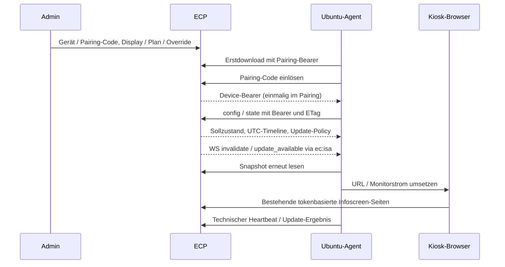

# Infoscreen-Agent: Architektur und Betriebsreferenz

Stand: 2026-11-07, S1–S7. Der Agent liegt im öffentlichen Repository
[BattloXX/Einsatzcockpit-Infoscreen-Agent](https://github.com/BattloXX/Einsatzcockpit-Infoscreen-Agent).
Benutzeranleitungen beginnen im [Wiki](../wiki/Infoscreen-Agent.md).

## Datenfluss



Der Browser lädt Einsatz-/GSL-Inhalte direkt aus den bestehenden Infoscreens.
Der Agent verarbeitet technische Steuerung; sein Store ist kein Einsatzarchiv.
`/config` enthält eine am Stundenbeginn verankerte 73-Stunden-Timeline (mindestens
72 Stunden ab Abruf) ausschließlich aus Plan und Ausnahmen,
keine vorausberechneten Einsätze. UTC wird in der DB naiv gespeichert, an Geräte
als ISO-Zeit mit Offset geliefert. Plan-Zeitzone löst DST serverseitig auf,
Org-Zeitzone bestimmt Admin-Eingaben und Updatefenster.

## Resolver-Priorität

Quelle: `app/services/infoscreen_agent_resolver.py`, Eingaben aus
`infoscreen_agent_snapshot.py`. Erste passende Zeile gewinnt:

| Rang | Bedingung | mode | Strom / Seite |
| --- | --- | --- | --- |
| 1 | Gerät nicht active, Display inaktiv oder Alarm-Token fehlt/ungültig | locked | an, feste schwarze Sperrseite |
| 2 | GSL aktiv, GSL-Override erlaubt und gültiger gsl_page | override | an, geprüfte Override-Seite |
| 3 | GSL aktiv | gsl | an, Alarm-Infoscreen |
| 4 | Regulärer Einsatz aktiv | incident | an, Alarm-Infoscreen |
| 5 | Letztes Ende ≤ jetzt < Ende + nachlauf_min | nachlauf | an, Alarm-Infoscreen |
| 6 | Gültiger manual-Override | manual | an, geprüfte Override-Seite |
| 7 | Slot / Ausnahmetag | schedule | Slot-Strom, Slot-Rotation |
| 8 | Sonst | default | an, bestehende Token-Rotation |

Intervalle sind halboffen `[von,bis)`. Override-Gleichstand: späterer Beginn,
dann größere ID. Ein gsl_page mit Beginn vor/auf dem letzten GSL-Ende bleibt
unwirksam, auch nach neuer GSL. Ausnahmetage schlagen Wochen-Slots, einschließlich
Vortagsüberhang; leere Ersatzliste und Lücken bedeuten aus. Danach entscheidet
Slot-Priorität, spätere lokale Startzeit und ID. Mehrdeutige DST-Zeiten verwenden
den früheren Beginn/späteren Schluss; nicht existente Zeiten werden vorwärts
aufgelöst. Ohne passenden Slot gilt Standard an.

`valid_until` begrenzt die Auflösung konservativ auf nächste Override-/Plan-Grenze
oder Nachlaufende; null bedeutet keine bekannte zeitliche Grenze, keine ewige
Gültigkeit. `update_allowed` ist false bei GSL, Einsatz, Nachlauf und locked.
Wartungsfenster und weitere Update-Policy prüft der Agent zusätzlich.
`revision` wird nur im Snapshot-Service per CAS und dauerhaftem Auflösungs-Hash
erhöht, ohne `server_time`; Resolver und Admin-/MCP-Vorschau schreiben nicht.
`config_version` steigt nach Konfigurationsänderungen.

## Speicherung

| Tabelle | Inhalt / Scope |
| --- | --- |
| infoscreen_device | Org-Gerät, gehashte Zugangsdaten, Presence, Heartbeat-/Update-Diagnose |
| infoscreen_display | Org-Display, Geräte-/Token-/Plan-Zuordnung, Konfiguration, Revision, gemeldeter Zustand |
| infoscreen_schedule / _slot / _exception | Org-Pläne, Wochen-Slots und Ausnahmetage |
| infoscreen_override | Org-/Display-Override, Zeitbereich, Begründung und Autor-/Aufhebe-Audit |
| infoscreen_url_allowlist | Exakte zusätzliche Hosts je Org |
| infoscreen_device_event | Technische Org-Diagnose, Codes/Zahlen, 90 Tage Retention |
| infoscreen_release | Plattformweite signierte Artefakte und Freigabe; kein org_id |
| infoscreen_release_upload_token | Plattformweite CI-Token-Hashes und Widerruf |
| org_settings | Org-Updatefenster und Freigabe kritischer Fenster-Ausnahmen |

Device-/Pairing-Authentifizierung beweist die Org bei öffentlichen Routen selbst.
Alle Folgeabfragen müssen zusätzlich Gerät und Org scopen. Release-Dateien liegen
außerhalb eines Static-Mounts; zufällige Namen, Dateien 0600, Verzeichnis bei Anlage
0700. Verwaiste Dateien nach hartem Prozessabbruch sind ohne DB-Zeile nicht abrufbar.

## Endpunkte

REST-Präfix: `/api/v1/infoscreen-agent`.

| Methode / Pfad | Authentifizierung | Zweck |
| --- | --- | --- |
| POST /pair | Einmal-Code im Body | Device-Token erzeugen; Code atomar verbrauchen |
| GET /config | Device-Bearer | Config/Timeline/Policy, ETag/304 |
| GET /state?display=KEY | Device-Bearer | Resolver-Snapshot, Revision/ETag |
| POST /heartbeat | Device-Bearer | Validierte technische Diagnose, kein Revisions-Increment |
| GET /update/manifest?arch=…&current=… | Device-Bearer | Freigegebenes Update und Policy; sonst update_available=false |
| POST /update/result | Device-Bearer | installing/ok/failed/rolled_back und fester Fehlercode |
| POST /unpair | Device-Bearer | Token widerrufen, Presence entfernen, WS trennen |
| POST /releases | CI-Upload-Bearer | Multipart metadata/package/install_sh/signature_install_sh |
| GET /download/latest?arch=…&channel=… | Unverbrauchter Pairing-Bearer | Erstinstallationsmanifest |
| GET /download/artifact/{id} | Pairing- oder Device-Bearer | Aktuell autorisiertes Paket; Device mit current-Parameter |
| GET /infoscreen-agent/install.sh (ohne REST-Präfix) | Öffentlich | Signaturgeprüftes Skript, Installer-Schalter |
| WS /ws/infoscreen-agent (ohne REST-Präfix) | Device-Bearer-Header | Presence, Ping/Pong, Wake-Hinweise |

Authentifizierte Release-/Download-Antworten sind `no-store`, keine Token in URLs.
Der Downloadpfad ist relativ und nutzt den jeweiligen Bearer statt separater
signierter URL-Tokens. Upload-Paketlimit 512 MiB, Skriptlimit 1 MiB.
Admin-Geräte/-Pläne unter `/admin/infoscreen-agent`, plattformweite Releases unter
`/admin/agent-releases`; Einordnung bleibt Infoscreens bzw. Updates & Backups.

## Events und mehrere Worker

`ec:isa` ist der Redis-Hinweiskanal im bestehenden `ws_bus`. Incident-/GSL- und
Planspiel-Broadcasts erzeugen nach Commit entkoppelte Wake-Hinweise; Konfiguration
und Overrides `config_changed`, Updates `update_available`. Details der Hooks:
[S3](infoscreen-agent-s3.md). WS sendet `invalidate` mit Revision, Grund und
Display-Key sowie `ping`; Update-Hinweise enthalten keine Release-/Einsatzdaten.
Hinweise können doppelt eintreffen oder dieselbe Revision tragen: der Agent muss
trotzdem config/state nachladen. Nur der Snapshot ist autoritativ.

Redis ist für zeitnahen workerübergreifenden Fanout erforderlich. Im Redis-Ausfall
wirken Hinweise lokal; Polling sowie Reconnect-Abgleich fangen verpasste Hinweise
auf. WebSocket-Ping alle 25 s, Pong-Frist 25 s, DB-Presence-TTL 75 s. Neue Verbindung
verdrängt alte; DB-Presence und Widerruf bleiben workerübergreifend maßgeblich.
Retention entfernt Diagnose nach 90 und abgelaufene Overrides nach 30 Tagen.

## Settings-Referenz

Namen/Defaults geprüft in `app/config.py:34–37`; keine neuen Settings in S7.

| Setting | Deklarierter Default | Wirkung |
| --- | --- | --- |
| INFOSCREEN_AGENT_KEY_FINGERPRINT | `""` | Expliziter Installer-Fingerprint; leer: aus erstem konfigurierten Public Key abgeleitet |
| INFOSCREEN_AGENT_INSTALLER_ENABLED | `False` | Harter Installer-Schalter; Updates separat nutzbar |
| INFOSCREEN_AGENT_RELEASE_PUBKEYS | `{}` | JSON-Objekt key_id → öffentlicher Ed25519-PEM; leer sperrt Uploads |
| INFOSCREEN_AGENT_RELEASE_STORAGE_DIR | `"app_storage/infoscreen_agent_releases"` | Persistente Release-Ablage relativ zum Arbeitsverzeichnis, falls nicht absolut |

In `.env` benötigt das Pubkey-Setting ein JSON-Objekt mit PEM-Zeilenumbrüchen als
JSON-`\n`, keine Liste. Formbeispiel mit absichtlich ungültigem Platzhalter:

```dotenv
INFOSCREEN_AGENT_RELEASE_PUBKEYS='{"release":"-----BEGIN PUBLIC KEY-----\n<BASE64-DES-ECHTEN-PUBLIC-KEYS>\n-----END PUBLIC KEY-----\n"}'
```

Der aktuelle Agent-Release-Workflow signiert mit `key_id="release"`; genau dieser
Mapping-Key muss vorhanden sein. Fingerprint = `sha256:` plus SHA256 des DER-Public-
Keys. Bei Rotation muss der Einzeiler zum eingebetteten Key des ausgelieferten
Skripts passen; expliziter Fingerprint vermeidet Abhängigkeit von JSON-Reihenfolge.
Private Keys gehören nie in ECP. Zusätzlich korrekte `PUBLIC_BASE_URL` (Fallback
`APP_BASE_URL`), TLS/Proxy-Vertrauen und Redis-Betrieb sicherstellen.
Org-DB-Defaults: `infoscreen_update_start="02:00"`, `infoscreen_update_end="04:30"`,
`infoscreen_critical_allowed=False`. `critical` ist laut aktuellem Vertrag **nicht
signiert**; es hebt mit Org-Freigabe nur das Fenster auf, keine Einsatzschutzregel.

## Betrieb und Wiederherstellung

Für `POST /api/v1/infoscreen-agent/releases` muss jeder vorgeschaltete Proxy
`client_max_body_size >= 520m` erlauben (512 MiB Paket plus Skript/Multipart).
Die Vorlagen unter `deploy/` haben allgemein 10m (Snippet) bzw. 110m (CloudPanel);
ihre zusätzliche Location bleibt
vollständig auskommentiert und muss vom Betrieb geprüft werden. Beispiel-Timeouts
300 s für Lesen/Senden und Body-Empfang sind an Uploadstrecke und Signaturprüfung
anzupassen; sie sind Inaktivitätsfristen, keine garantierte Gesamtzeit.
WebSocket-Upgrade und lange WS-Timeouts erhalten, Authorization weiterreichen,
Bearer/Code/Token-URLs aus Logs fernhalten. Speicherplatz auch für temporäre
Uploads und alte Releases vorhalten. Kein produktives Proxy-Limit wird durch S7
aktiviert.

DB und Release-Ablage konsistent gemeinsam sichern und wiederherstellen;
Org-Exports enthalten weder plattformweite Releases noch CI-Upload-Tokens und
ersetzen kein Plattform-Backup. Nach Restore Hash-/Signaturprüfung, Download,
Pilot-Heartbeat und Update-Policy prüfen; bei Zugangsdatenverdacht Tokens widerrufen.
Migration/Deploy-Checkliste: [Runbook](../MIGRATION_RUNBOOK.md#infoscreen-agent-migrationen-03550358).
Hardware-Pilot, Aufwachzeit und Rollback müssen am echten Gerät abgenommen werden.
Der aktuelle Agent-Release-Workflow verlangt im Archivschritt noch ein privates
Repository und bricht im öffentlichen Repository vor dem ECP-Upload ab; diese
Upstream-Grenze und die CI-Secret-Namen sind im Runbook beschrieben.
Der aktuelle Release-Build ist Ubuntu-/Python-gebunden, der Download selektiert
noch keine OS-Version; 26.04-Freigabe erfordert passende Paketzuordnung.

Der Agent-Vertrag beschreibt bei kritischen Updates auch eine Pin-Ausnahme.
Der aktuelle ECP-Selektor erzwingt den Geräte-Pin weiterhin; diese Servergrenze
ist für die tatsächlich ausgelieferten Releases maßgeblich.

## Lesender MCP-Vertrag

`infoscreen_geraete_liste()` und `infoscreen_display_status(device_id)` verwenden
die bestehende Registry, OAuth-Live-Rechteprüfung, Org-Bindung und Worker-Ausführung.
Rolle `org_admin`, bestehende Admin-Aliase wie UI, kein eigenes Modulflag zusätzlich
zu MCP. Ersteres liefert Name, online/offline, Agent/OS, letzten Heartbeat UTC,
Kanal, Update-Status/-Fehlercode und Displayanzahl. Letzteres liefert je Display
aktuellen Resolver-Modus/Sollstrom/valid_until, letzten gemeldeten Strom/Seitenstatus,
Backend/verified und wirksamen Override. `page_state` ist ein technischer Status,
keine URL. Keine Rotation, Einsatzdetails, Codes, Token, Hostnamen oder IPs.
Kein `state()`-Aufruf, kein Commit und keine Revisions-/Auditänderung.
Eine fremde/unbekannte device_id liefert denselben Fehler. Tools sind im bestehenden
MCP-Katalog sichtbar, ohne neue Verwaltungsseite oder Hauptnavigation.

Weiterführend: [Overrides](infoscreen-agent-overrides.md),
[Releases und Signaturformat](infoscreen-agent-releases.md).
