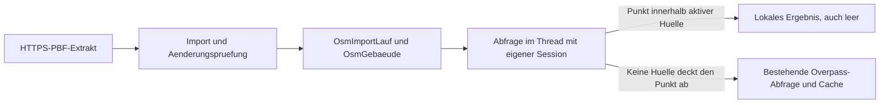

# Lokaler OSM-Gebaeudebestand

Der oeffentliche Overpass-Dienst ist fuer regelmaessige automatisierte
Gebaeudeabfragen unzuverlaessig. Regionale OSM-PBF-Extrakte werden deshalb lokal
importiert. Alle Tabellen enthalten ausschliesslich oeffentliche globale Daten
und haben bewusst kein TenantScoped und keine org_id.



Die Abdeckung ist die rechteckige Huelle aller importierten Gebaeude, keine
Verwaltungsgrenze. Innerhalb dieser Huelle wird niemals wegen leerer Treffer auf
Overpass zurueckgefallen. Die Suche nutzt eine Bounding-Box und den Abstand zum
Gebaeudemittelpunkt mit halber Ausdehnung; die Laengengradumrechnung beruecksichtigt
cos(lat). Ausgabe nach Abstand sortiert, maximal 100 Gebaeude. Bei ueberlappenden
Quellen werden Way-IDs dedupliziert, das Alter richtet sich nach dem aeltesten
verwendeten Stand.

Importiert werden nur geschlossene Ways mit building-Tag und mindestens drei
verschiedenen, endlichen Ecken. Ways mit fehlenden Node-Koordinaten werden
uebersprungen. Multipolygon-Relationen bleiben bewusst aussen vor, entsprechend
der bisherigen Overpass-Abfrage `way["building"]`. Der doppelte Schlusspunkt wird
entfernt; Ecken werden auf sieben Nachkommastellen gerundet und mit SHA-256
verglichen. Die Datenbank speichert naive UTC; API-Datenstaende haben ein Z-Suffix.

## Quellen und Lizenz

Standard ist der taeglich aktualisierte
[Vorarlberg-Extrakt von OpenStreetMap France](https://download.openstreetmap.fr/extracts/europe/austria/vorarlberg-latest.osm.pbf).
Geofabrik bietet fuer Oesterreich nur das
[Gesamtland](https://download.geofabrik.de/europe/austria-latest.osm.pbf).
Die Daten unterliegen der ODbL. Attribution: **OpenStreetMap-Mitwirkende**;
[Lizenz und Urheberrecht](https://www.openstreetmap.org/copyright).
Die bestehende Kartenattribution bleibt erforderlich.

## Konfiguration

| Einstellung | Standard | Bedeutung |
|---|---|---|
| OSM_GEBAEUDE_IMPORT_ENABLED | true | Lokale Abfrage und automatischen Import aktivieren |
| OSM_GEBAEUDE_QUELLEN | vorarlberg=https://download.openstreetmap.fr/extracts/europe/austria/vorarlberg-latest.osm.pbf | Kommagetrennte Liste name=url |
| OSM_GEBAEUDE_AKTUALISIERUNG_TAGE | 7 | Mindestabstand erfolgreicher Importe |
| OSM_GEBAEUDE_MAX_ALTER_TAGE | 30 | Altersschwelle fuer Georef-Speicherung |
| OSM_GEBAEUDE_MAX_DOWNLOAD_MB | 1200 | Maximale Downloadgroesse, auch beim Streaming geprueft |
| OSM_GEBAEUDE_MAX_AENDERUNG_ANTEIL | 0.2 | Anteil, ab dem eine manuelle Pruefung erforderlich ist |
| OSM_GEBAEUDE_DATA_DIR | app_storage/osm | PBF-Dateien und Sperrdateien |

Quellennamen muessen `[a-z0-9_-]{1,40}` erfuellen, URLs muessen HTTPS verwenden.
Ungueltige und doppelte Eintraege werden mit Warnung ignoriert. Weiterleitungen
werden begrenzt und vor jedem Folgeabruf auf HTTPS geprueft. Downloads nutzen
HYDRANT_USER_AGENT, werden nach `<name>.osm.pbf.tmp` gestreamt und atomar umbenannt.
If-Modified-Since verwendet den aktiven Datenstand. Bei 304 entstehen keine
neuen Laeufe und beendet_am bleibt unveraendert. Datenstand kommt bevorzugt aus
osmosis_replication_timestamp im PBF-Header, sonst aus HTTP Last-Modified.
Ein unbekannter Datenstand gilt fuer die Speicherung als veraltet.

## Aenderungsschutz und Betrieb

Ein Lauf startet als laeuft. Der Vergleich erfolgt per SQL anhand osm_way_id und
ecken_hash: neu, geaendert, entfernt. Ueberschreitet
`(entfernt + geaendert) / max(1, alte Anzahl)` die Schwelle oder sinkt die Anzahl
um mehr als diesen Anteil, wird der Lauf auf pruefung gesetzt. Der alte Bestand
bleibt aktiv. Ein Erstimport wird unmittelbar aktiv. Nur der neueste Lauf in
pruefung behaelt seine Zeilen; aeltere werden auf verworfen gesetzt und geleert,
damit taegliche Versuche keinen weiteren Vollbestand anlegen.

Der Wechsel von aktiv zu ersetzt und von laeuft/pruefung zu aktiv erfolgt in einer
Transaktion. Danach werden alte Gebaeudezeilen in Batches geloescht. Pro Quelle
bleibt hoechstens ein ersetzter Lauf als Metadaten. Prueflaeufe behalten ihre Daten
bis zur manuellen Aktivierung. Eine Dateisperre pro Quelle serialisiert CLI und
Hintergrundimport auf demselben Host; DATA_DIR muss deshalb fuer diese Prozesse
dasselbe Verzeichnis sein. Beim Aufraeumfehler bleibt der aktivierte Lauf aktiv;
der naechste Import wiederholt das Aufraeumen. Nicht mehrere Hosts mit getrennten
DATA_DIR-Verzeichnissen fuer dieselbe Quelle importieren lassen.

Download-, Parse- und DB-Fehler setzen den Lauf auf fehler; seine Gebaeudezeilen
werden entfernt. Der aktive Bestand bleibt unveraendert. Fehlercodes sind
OSM_DOWNLOAD_HTTP, OSM_DOWNLOAD_ZU_GROSS, OSM_DOWNLOAD_TIMEOUT, OSM_PARSE_FEHLER
und OSM_DB_FEHLER. DB-Ausfaelle koennen auch das Schreiben des Fehlerstatus
verhindern; der Hintergrundlauf protokolliert die Ausnahme und setzt bei der
naechsten Quelle fort.

Nur der Leader startet den automatischen Import: einmal 120 Sekunden nach Start,
danach taeglich um 03:30 Europe/Vienna. Jede Quelle wird in einem eigenen
asyncio.to_thread-Aufruf synchron importiert. Der Mindestabstand von sieben Tagen
gilt weiterhin. Bei deaktiviertem Import verwendet die Abfrage ausschliesslich
das bisherige Overpass-Verhalten. Die CLI bleibt fuer bewusste Wartung nutzbar.

```bash
.venv/bin/python -m app.cli osm-gebaeude-status
.venv/bin/python -m app.cli osm-gebaeude-import --quelle vorarlberg --erzwingen
.venv/bin/python -m app.cli osm-gebaeude-aktivieren 123
```

Die CLI zeigt JSON mit Status, Datenstand, Anzahl und Alter; Importergebnisse
uebersprungen und unveraendert werden gesondert ausgewiesen. status zeigt pro
Quelle den aktiven Lauf, den letzten Fehler und wartende Pruefungen. Ein
fehlgeschlagener Import beendet die CLI mit Exitcode 1.

Beim Deploy im aktivierten venv:

```bash
pip install -e .
alembic upgrade head
python -m app.cli osm-gebaeude-import --erzwingen
```

Im Repository entsprechend `.venv/bin/python -m pip install -e .`,
`.venv/bin/python -m alembic upgrade head` und `.venv/bin/python -m app.cli ...`
verwenden. Migration 0335 benoetigt keine Tenant-Datenmigration.

## Alter und Georeferenzierung

Lokale Antworten enthalten datenstand (ISO UTC), alter_tage, veraltet und
cache_status=lokal. Ueberschreitet das Datenalter OSM_GEBAEUDE_MAX_ALTER_TAGE,
kommt eine warnung hinzu. Alte Daten bleiben fuer die Analyse verfuegbar.
objekt_karte_georef_zuordnen gibt diese Felder weiter, verweigert aber
speichern=True mit der Aufforderung, den Import zu aktualisieren. Klasse A,
expected_rotation und Rollenpruefung gelten unveraendert. Kartenmarker werden
von diesem Ablauf weder freigegeben noch veraendert.

## Speicher und RAM

Lokal gemessen fuer Vorarlberg mit pyosmium 4.3.2: PBF etwa 44 MB, 173.907
Gebaeude-Ways in etwa 2,2 Sekunden, 169 MB RSS beim Einlesen. Der vollstaendige
Import mit SQL-Schreibzugriffen dauert laenger. flex_mem haelt Node-Koordinaten
im Speicher; die Gebaeude werden in Batches von 5000 geschrieben. Ein
Oesterreich-Gesamtextrakt braucht deutlich mehr RAM; vor Umstellung Kapazitaet
und Importzeit am Zielsystem messen. Waehrend Import und Pruefung koexistieren
alter und neuer SQL-Bestand. DATA_DIR braucht Platz fuer fertigen und temporaeren
Download, die Datenbank fuer aktive und wartende Laeufe.
