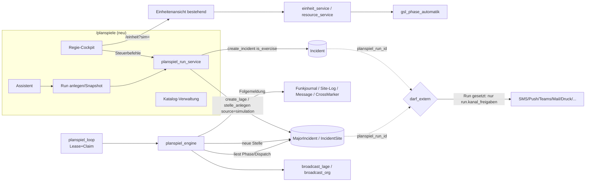

# Planspiele & Simulation – Implementierungsplan

> **Status:** Plan freigegeben am 2026-10-14 (noch keine Implementierung), Basis `main` @ `de312afb` (#573), letzte Migration `0283`.
> **Quelle:** Fachkonzept „ECP Planspielgenerator“ (14.10.2026).
> **Prozessregel:** Eine Phase = ein Codex-Auftrag = ein PR; Merge erst nach grüner CI (ruff, mypy, pytest `-n auto`, `npm run test:js`, Migrationsjob MariaDB).

## Kontext

Die Feuerwehr will Übungseinsätze und Übungs-GSLs automatisch erzeugen und steuern können: Szenarien aus einem pflegbaren Katalog, plausible reale Orte, zeitgesteuerte Folgemeldungen, ein Unwettergenerator für die GSL und eine Regie, mit der eine einzelne Person das ganze ECP durchspielen kann. Die Teilnehmer arbeiten dabei in den normalen ECP-Ansichten. Es dürfen keine echten Alarme hinausgehen. Grundsatz: keine zweite Einsatz-, GSL-, Journal-, Benachrichtigungs- oder Ressourcenlogik bauen, sondern die vorhandenen Services aufrufen.

---

## 1. Bestandsaufnahme (verifiziert)

| Bereich | Stand im Code | Beleg | Folgerung |
|---|---|---|---|
| Übungsflag | `is_exercise` nur auf `Incident` und `MajorIncident`. Stellen, Aufträge und Sperren haben keins. | `app/models/incident.py:90`, `app/models/major_incident.py:273` | Stellen erben das Flag von der Lage. Die Run-Zuordnung kommt als neue FK-Spalte. |
| Zentraler Übungs-Guard | `darf_extern(kanal, *, is_exercise, org_id, db)` mit 12 Kanälen, fail-closed. Freigabe **org-weit** über `OrgSettings.uebung_*`, `einsatzinfo_*_send_exercise`, `gk_sms_uebung`, Teams `send_exercise`, PrintRule-Filter, `Objekt.kontakt_info_uebung`. 28 Aufrufstellen. | `app/services/exercise_guard.py`, Tests `tests/test_uebung_side_effects.py` | **Lücke:** Eine Org, die SMS für manuelle Übungen freigibt, würde sie auch für Generatorläufe freigeben. → Run-gebundene, strengere Sperre (Abschnitt 6). |
| Ungeprüfte Kanäle | `task_reminder.py` (Push), `road_closure_service.create_closure` (Teams-Enqueue), `gsl_lagemeldung_reminder.py`, öffentliche QR/PIN-Zugänge | Bericht Explore | Für Planspiel-Objekte explizit sperren bzw. nicht benutzen. |
| Einsatzanlage | `create_incident(db, alarm_type_code, *, is_exercise, address_*, lat, lng, report_text, reason, …) -> (Incident, bool)` schreibt nur in die DB. Die Außenwirkung lösen die Aufrufer aus: `notify_incident_created`, Geocoding, `match_incident_background`, Autodruck, `broadcast_org`, Nachbarn. | `app/services/incident_service.py:282`, `ui_incident.py:446-630` | Der Generator ruft `create_incident` direkt auf und führt nur die erlaubten Folgeschritte aus. |
| Übungseinsatz heute | `uebungseinsatz_erstellen` aus der Probenplanung, Start getrennt. | `app/services/probe_exercise_service.py:34`, `ui_probenplanung.py:1209-1306` | Vorbild für einen zweistufigen Ablauf (anlegen → starten). |
| Alarm-Outbox | `IncidentAlarmJob` je Kanal. `alarm_unterdrueckung_grund` erzeugt `suppressed`-Jobs. Claim per bedingtem `UPDATE` mit `lease_until`. | `app/services/alarm_outbox.py:79`, `incident_notify.py:37` | Neuer Unterdrückungsgrund „Planspiel“. Das Claim-Muster gilt auch für den Planspiel-Worker. |
| Stichworte | `AlarmType` je Org (code, category, label, `triggers_major_incident`). 19 Codes werden als Seed angelegt (F1–F5, F10, F11, F14, F21, F30, T1–T7, T9, T21). `Incident.alarm_type_code` ist String ohne FK. | `app/models/master.py:246`, `app/seed_data.py:43,397` | **Wiederverwenden** als offizielle Stichwortliste. Keine zweite Tabelle. Die LFV-Langtexte kommen read-only als Code-Daten dazu. |
| GSL | `create_lage(db, org_id, name, *, is_exercise, …)` ist eine reine Anlage. Die Route `POST /lage/neu` legt zusätzlich die Einheiten-Seeds an und führt `notify_gsl_created` (SMS/Teams), Autodruck und Live-Push aus. | `major_incident_service.py:124`, `ui_major_incident.py:263` | Die Seeds der Route werden in einen Service ausgelagert. Planspiel ruft ihn **ohne** `notify_gsl_created` auf. |
| GSL-Stelle | `stelle_anlegen(db, lage, *, bezeichnung, einsatzgrund, ort, strasse, hausnr, lat, lng, user_id, author_name)` macht Geocoding, KI-Prio, Log, Audit und Abschnitt. `source` ist immer `manual`. Danach `gsl_broadcast.stelle_angelegt`. | `gsl_stelle_service.py:49`, `gsl_broadcast.py` | `source`-Parameter (`"simulation"`) und `geocode`/`ki_prio`-Schalter ergänzen. |
| Phasenautomatik | `aktualisiere_site_phase` wird aus `resource_service` und `einheit_service.setze_einheit_status` aufgerufen. | `gsl_phase_automatik.py:44` | Bleibt unverändert. Planspiel löst sie nur über die normalen Dispositions- und Statuspfade aus. |
| Einheiten-Simulation | `/einheit?sim=<id>` setzt `quelle="simulation"`. Schreiben ist nur bei `lage.is_exercise` erlaubt (`_schreibbar`). Erfordert heute die Rolle `admin`. Autor: „X (Simulation Einheit)“. | `ui_einheit.py:84`, `einheit_service.py:258,282,383` | **Wiederverwenden.** Die Berechtigung wird um „Übungsleiter dieses Runs“ erweitert. |
| Journale/Audit | `LageJournalEntry` (mit `quelle`, `ereignis_typ`), `CommLogEntry`/`add_comm_entry`, `add_site_log`, `CrossSiteMarker`/`cross_marker_service.anlegen`, Einsatz-`Message` (`incident.py:532`), `IncidentLog`, `write_audit` | `lage_journal_service.py`, `funkjournal_service.py`, `site_log_service.py:32`, `app/core/audit.py:6` | Folgemeldungen landen in **diesen** Kanälen. Es entsteht kein eigenes Journal. |
| Adressen/Gebiet | Kein Adresspool, kein Org-Polygon. Nominatim (`geocoding.py`), Photon (`address_autocomplete.py`), Overpass (`osm_street_service.py`). `FireDept.fallback_lat/lng`. | Explore-Bericht | Ein Adresspool und eine Gebietsdefinition werden **neu** gebaut (Phase C). |
| Objekte | `Objekt` mit `kategorie_id`→`ObjektKategorie` (frei je Org), lat/lng, Status. BMA als 1:1 `ObjektBMA`. | `app/models/objekt.py:195,352` | `requires_verified_bma` = `ObjektBMA` vorhanden und Objekt `freigegeben`. Eine Zuordnung Kategorie → Ortstyp wird gepflegt. |
| Rechte | Rollen-Codes statt Permission-Strings: `require_role`, `has_role`, Rollengruppen in `app/core/permissions.py`. Neue Rolle über `seed_data.ROLES` (Upsert bei jedem Start). | `permissions.py:6-48`, `seed_data.py:22` | Neue Rollen statt Permission-Strings, keine Migration nötig. |
| Modulschalter | Systemflag (`SystemSettings`) + Org-Flag (`OrgSettings.*_modul_aktiv`) → `request.state.*_enabled` | `app/core/dependencies.py:113-199`, Vorbild `road_closure_flags.py`, Migration `0257` | Gleiches Muster für `planspiel`. |
| Hintergrundjobs | Etwa 34 asyncio-Loops in `_start_background_loops`, Leader per `flock`. Prod: gunicorn `-w 1`. | `app/main.py:200-350`, `leader_lock.py`, `deploy/einsatzleiter.service` | Neuer `planspiel_loop`. Die Sicherheit liegt trotzdem in der DB (Lease + Unique), weil der Leader-Lock fail-open ist. |
| Versionierte Vorlagen | `ChecklistTemplate` (`code`, `aktive_version_id`, Versionen, idempotenter `standardvorlage_importieren`) | `app/models/probenplanung.py:86-150`, `checklist_template_service.py` | **Vorbild** für den Szenariokatalog. |
| Statistik | `stats_service.get_stats` trennt `is_exercise` | `stats_service.py:88` | Bereits erfüllt. Nur ein Test kommt dazu. |
| PDF | WeasyPrint-Muster `render_statistik_bericht_pdf` | `pdf_service.py:475` | Für den Übungsbericht verwenden. |

## 2. Architekturentscheidungen

| # | Entscheidung | Begründung |
|---|---|---|
| P1 | Neues Modul `planspiel` mit System- und Org-Flag (`planspiel_module_enabled`, `OrgSettings.planspiel_modul_aktiv`), standardmäßig aus. | Gleiches Muster wie bei den Straßensperren. Ein Rollout pro Org ist möglich. |
| P2 | Rollen statt Permission-Strings: `uebungsleiter` (anlegen, steuern, simulieren, auswerten) und `uebungsbeobachter` (lesen, beobachten). Katalogpflege bleibt bei `org_admin`. Die Regie-Assistenz wird je Run über `planspiel_mitglied` (Rolle `leiter`/`regie`/`beobachter`) vergeben. | Das RBAC des Repos kennt nur Rollen. Ein Run-Mitglied deckt „Regie nur für diese Übung“ ab, ohne systemweite Rechte zu vergeben. |
| P3 | Generierte Einsätze und Lagen bekommen `planspiel_run_id` (nullable FK, `ondelete SET NULL`) auf `incident` und `major_incident`. Stellen und Marker hängen über `source="simulation"` und `planspiel_ziel` am Run. | So bleibt die Erweiterung der Bestandsschemas minimal, und der Guard kann am Objekt prüfen. |
| P4 | Der Guard wird erweitert: `darf_extern(..., planspiel_run_id: int \| None = None)`. Ist die Run-ID gesetzt, gilt **ausschließlich** `planspiel_run.kanal_freigaben`. Standard ist alles gesperrt, auch Geocoding. Die Org-Übungsflags werden ignoriert. Ein AST-Test erzwingt, dass jeder Aufruf `planspiel_run_id=` übergibt. | Die Sperre greift zentral, kann nicht umgangen werden und weicht die bestehenden Org-Freigaben nicht auf. |
| P5 | Kanal-Opt-ins (Übungs-Teams-Webhook, Whitelist-SMS, Übungsdruck) gehören **nicht zum MVP**. Spalte und UI sind vorbereitet, aber deaktiviert (Phase G). | Das Risiko sinkt, und der MVP bleibt klein. |
| P6 | Katalog: Die Systemvorlagen liegen als versionierte Python-Daten in `app/data/planspiel_katalog.py` (`SYSTEM_KATALOG_VERSION`). Daraus entstehen **Org-Kopien** mit Versionen (Muster `ChecklistTemplate`). Das Update überschreibt nie. Unveränderte Org-Kopien bekommen bei einem neuen Systemstand automatisch eine neue Version. Geänderte zeigen „Systemupdate verfügbar“ mit Diff und manuellem Übernehmen. | Org-Änderungen bleiben erhalten. Laufende Runs halten einen Snapshot, ältere Versionen bleiben unverändert. |
| P7 | Die offiziellen Stichworte kommen aus dem bestehenden `AlarmType` je Org. Die LFV-Referenztexte (V03, 02/2021) liegen read-only in `app/data/lfv_stichworte_v03.py` mit Quelle und Revision. Die Szenarien verweisen per `stichwort_code` (String) darauf. Fehlt der Code in der Org, gibt es eine Warnung, und beim Start wird auf `T1`/`F1` zurückgefallen. | Es entsteht keine Doppeltabelle, und die historische Vorlage wird nicht überschrieben. |
| P8 | Ereignisse sind relational (`planspiel_szenario_ereignis` je Version, `planspiel_run_ereignis` je Run). Nur Payload und Konfiguration liegen als JSON. | Die Abfragen nach Status und Fälligkeit brauchen Indizes. |
| P9 | Übungsuhr: `sim_s = (jetzt − gestartet − pausiert_summe) × tempo`. Ereignisse speichern `faellig_sim_s`. Pause friert die Uhr ein. | Die Pausensemantik ist eindeutig, und ein Neustart des Servers ist unkritisch. |
| P10 | Ausführung: Ein `planspiel_loop` (Tick 2 s) im Leader. Ein Run-Lease (`worker_lease_until`, Claim per bedingtem UPDATE wie bei der Alarm-Outbox) und ein Event-Claim per bedingtem UPDATE `geplant→laeuft`. Die Ausführung und `ausgefuehrt` laufen in **einer** Transaktion. Unique-Schlüssel sind `(run_id, seq)` und `idempotenz_key`. Vor dem Commit wird `run.steuer_version` neu gelesen (MariaDB `FOR UPDATE`). Bei Pause/Stop dazwischen folgt ein Rollback und die Freigabe. | Doppelausführung ist ausgeschlossen, auch bei zwei Prozessen. Das Stop-Race ist abgesichert. |
| P11 | Reaktive Trigger (`phase_reached`, `assignment_created/completed`) werden im Worker durch **Polling des Ist-Zustands** ausgewertet (Phase der Stelle, Dispatch-Status). In `gsl_phase_automatik`/`resource_service` kommen keine Hooks. | Die Phasenautomatik bleibt unverändert, und die Kopplung ist lose. |
| P12 | Der Adresspool ist neu (`planspiel_adresse`). Quellen: freigegebene Objekte inkl. Zusatzadressen, geokodierte Adressen früherer Realeinsätze, ein optionaler OSM-Import (Overpass `addr:housenumber` im Gebiet) und Straßenpunkte aus `osm_street_service`. Jeder Eintrag hat eine Qualitätsstufe und Ortstypen. Das Gebiet ist ein GeoJSON-Polygon in den Planspiel-Einstellungen, ersatzweise ein Radius um `FireDept.fallback_lat/lng`. | Es gibt keine erfundenen Hausnummern. Ohne Pool kommt ein klarer Fehler. |
| P13 | Eine Übungssperre ist ein `CrossSiteMarker` (Typ Sperre) in der Übungs-GSL, **niemals** eine `RoadClosure`. | `create_closure` schickt Teams-Meldungen ohne Übungsprüfung. |
| P14 | Ohne KI: Den Stichwortvorschlag liefert eine Textsuche über Titel, Schlagworte und Alarmtext. Bei einer GSL-Stelle ist die KI-Prio im Planspiel aus. | Das ist deterministisch und Voraussetzung für Seed-Wiederholbarkeit. |
| P15 | Determinismus: `random.Random(f"{seed}:{zweck}:{seq}")` je Ziehung. Pool und Katalog werden beim Start als Snapshot im Run gespeichert. | Gleicher Seed + Snapshot ergibt dieselbe Abfolge. |

## 3. Zielarchitektur



**Neue Dateien (Kern):**
- `app/models/planspiel.py` – alle Tabellen (Abschnitt 4).
- `app/data/planspiel_katalog.py`, `app/data/lfv_stichworte_v03.py`.
- `app/services/planspiel_katalog_service.py` – Import, Versionen, Duplizieren, JSON-Import/Export (pydantic-Schema).
- `app/services/planspiel_ort_service.py` – Gebiet, Pool, Ortswahl.
- `app/services/planspiel_run_service.py` – Anlage, Snapshot, Start und Zustandsautomat.
- `app/services/planspiel_engine.py` – Uhr, Trigger, Ereignisausführung, GSL-Generator.
- `app/services/planspiel_loop.py` – Lease/Claim-Loop.
- `app/services/planspiel_auswertung_service.py`.
- `app/routers/ui_planspiel.py`, `ui_planspiel_admin.py`, Templates `app/templates/planspiel/`.

## 4. Datenmodell (Migration ab `0284`)

Alle Tabellen sind `TenantScoped` und in `_TENANT_TABLE_NAMES` (`app/core/tenant.py`) eingetragen. Zeiten sind naive UTC.

**Katalog**
- `planspiel_szenario`: `id`, `org_id`, `code` (unique je Org), `herkunft` (`system`/`org`), `system_code`, `system_version` (Stand der Übernahme), `org_geaendert` (bool), `aktiv`, `zufall_erlaubt`, `gewicht`, `aktive_version_id`, `archiviert_at`, Audit-Felder.
- `planspiel_szenario_version`: `szenario_id`, `version`, `veroeffentlicht_at`, `titel`, `beschreibung`, `kategorie` (brand/technik/gsl/sonstiges), `stichwort_code`, `stichwort_quelle`, `alarmtext_template`, `regie_geheimlage`, `grundsituation`, `ort_typen` (JSON-Liste), `geografie_bedingung` (JSON, Whitelist-Schlüssel), `requires_existing_object`, `requires_verified_bma`, `min_adressqualitaet`, `schwierigkeit` (leicht/mittel/schwer), `schlagworte`, `lernziele`, `ressourcenhinweis`, `ausschlussregeln` (JSON), `gsl_modus` (null/hochwasser/sturm/kombination), `gsl_verteilung` (JSON).
- `planspiel_szenario_ereignis`: `version_id`, `baustein_code`, `ereignis_typ` (aufklaerung/eskalation/komplikation/entspannung/lageweit/funk/duplikat), `trigger_type` (`elapsed_time`/`phase_reached`/`assignment_created`/`assignment_completed`/`manual`/`condition`), `offset_min_s`, `offset_max_s`, `trigger_param` (JSON, z. B. `{"phase":"erkundung"}`), `wahrscheinlichkeit`, `max_fires`, `prioritaet`, `sichtbarkeit` (teilnehmer/regie), `ziel` (stelle/lage/einheit/regie), `payload_template`, `voraussetzungen`/`abbruch` (JSON, Whitelist), `reihenfolge`.
- `planspiel_ort_typ_zuordnung`: Mapping `ObjektKategorie`/OSM-`building` → Ortstyp (je Org pflegbar).

**Ort**
- `planspiel_adresse`: `org_id`, `quelle` (objekt/zusatzadresse/einsatzhistorie/osm/strassenpunkt/manuell), `quell_id`, `strasse`, `hausnr`, `plz`, `ort`, `lat`, `lng`, `qualitaet` (A verifiziert-objekt / B geokodiert-Hausnummer / C Straßenpunkt), `ort_typen` (JSON), `aktiv`, `zuletzt_verwendet_at`. Index `(org_id, aktiv)`.
- `OrgSettings` bekommt neue Spalten: `planspiel_modul_aktiv`, `planspiel_gebiet_geojson` (Text), `planspiel_gebiet_radius_m`, `planspiel_max_laufende_runs`, `planspiel_max_stellen_je_minute`, `planspiel_gsl_gewichte` (JSON).

**Run**
- `planspiel_run`: `org_id`, `titel`, `art` (einzel/gsl/drehbuch), `erzeugung` (manuell/teilauto/zufall), `status` (`entwurf`, `bereit`, `laeuft`, `pausiert`, `generierung_gestoppt`, `beendet`, `abgebrochen`), `seed`, `tempo`, `konfig` (JSON), `szenario_snapshot` (JSON: Version und Ereignisse eingefroren), `kanal_freigaben` (JSON, Standard `{}`), `leiter_user_id`, `incident_id`, `lage_id`, `gestartet_at`, `pausiert_seit`, `pausiert_summe_s`, `gen_aktiv`, `folge_aktiv`, `naechste_gen_sim_s`, `gen_seq`, `max_stellen`, `max_laufzeit_s`, `steuer_version`, `worker_lease_until`, `worker_id`, `letzter_fehler`, `beendet_at`. Index `(org_id, status)`.
- `planspiel_run_ereignis`: `run_id`, `seq`, `quelle` (szenario/regie/generator), `baustein_code`, `ziel_typ`/`ziel_id`, `trigger_type`, `trigger_param`, `faellig_sim_s`, `status` (`geplant`/`faellig`/`laeuft`/`ausgefuehrt`/`uebersprungen`/`fehlgeschlagen`/`abgebrochen`), `idempotenz_key` (unique), `versuche`, `lease_until`, `ausgefuehrt_at`, `ausgefuehrt_sim_s`, `ergebnis_ref` (JSON: journal_id, site_id …), `fehler`, `sichtbarkeit`, `text`. Unique `(run_id, seq)`, Index `(run_id, status, faellig_sim_s)`.
- `planspiel_ziel`: `run_id`, `seq` (unique je Run), `typ` (incident/site/marker), `incident_id`/`site_id`/`marker_id`, `szenario_code`, `stichwort_code`, `adress_snapshot` (JSON inkl. Qualität und Quelle), `ist_duplikat_von`, `erzeugt_sim_s`.
- `planspiel_mitglied`: `run_id`, `user_id`, `rolle` (leiter/regie/beobachter).
- `planspiel_beobachtung`: `run_id`, `user_id`, `sim_s`, `lernziel`, `kategorie`, `text`, `bewertung` (1–5, optional).
- Simulierte Rollen- und Einheitenhandlungen: **keine eigene Tabelle**. Es reichen `write_audit` (`planspiel.sim.*`, payload `acting_as`, `run_id`) und die bestehende Journal-`quelle="simulation"`.

**Bestand erweitert:** `incident.planspiel_run_id`, `major_incident.planspiel_run_id` (Index). In `IncidentSite.source` und `CrossSiteMarker.source` kommt der Wert `simulation` dazu (String passt).

**Rollback:** Die Migration fügt nur Tabellen und Spalten hinzu, `downgrade` entfernt sie. Die Katalog-Seeds laufen per Service beim Modulaktivieren bzw. über einen Admin-Button, nicht in der Migration.

## 5. Szenariokatalog und Folgemeldungen

### 5.1 Baustein-Bibliothek (`app/data/planspiel_katalog.py: BAUSTEINE`)
Jeder Baustein hat Typ, Text-Template, Standard-Trigger und Ziel. Die Szenarien verweisen per Code darauf. In der Verwaltung werden sie als eigene Ereigniszeilen je Version kopiert und sind dann frei editierbar.

| Code | Typ | Text (Template) | Standard-Trigger |
|---|---|---|---|
| AUF-URSACHE | Aufklärung | Ursache bestätigt: {ursache} | assignment_completed (Erkundung) |
| AUF-FEHL | Aufklärung | Keine Gefahr feststellbar / Fehlalarm | assignment_completed (Erkundung), p=0.3 |
| AUF-MELDERGR | Aufklärung | BMA: Meldergruppe {gruppe} ausgelöst, Bereich {bereich} | elapsed 120 s |
| AUF-WARTUNG | Aufklärung | Betreiber meldet Wartungsarbeiten im Bereich | phase_reached erkundung |
| ESK-STIEGENHAUS | Eskalation | Stiegenhaus zunehmend verraucht | elapsed 180–300 s |
| ESK-PERS-BALKON | Eskalation | Person am Balkon {stock} sichtbar | phase_reached erkundung |
| ESK-NACHBAR | Eskalation | Rauch dringt in Nachbarwohnung | elapsed 600–900 s |
| ESK-AUSBREITUNG | Eskalation | Brand breitet sich auf {bereich} aus | elapsed 480–720 s |
| ESK-WEITERE-PERS | Eskalation | Weitere betroffene Person gemeldet | elapsed 240 s |
| ESK-STICHWORT | Eskalation | Lageänderung – Vorschlag Stichwort {neu} (Regie entscheidet) | manual |
| ESK-FAHRZEUGLAGE | Eskalation | Fahrzeug instabil / schwierige Lage | phase_reached in_arbeit / Einsatz „vor Ort“ |
| ESK-PEGEL | Eskalation | Bachpegel steigt deutlich | elapsed 300–900 s |
| ESK-WEITERE-KELLER | Eskalation | Weitere Keller in {strasse} betroffen | elapsed 600 s |
| ESK-GEFAHRBEREICH | Eskalation | Wind dreht – Gefahrenbereich anpassen | elapsed 600 s |
| ESK-HANGBEWEGUNG | Eskalation | Erneute Bewegung im Hang beobachtet | elapsed 600–1200 s |
| KOM-ZUFAHRT | Komplikation | Zufahrt blockiert durch {hindernis} | elapsed 480 s |
| KOM-GERAET | Komplikation | Ausfall {geraet} gemeldet | manual |
| KOM-FUNK | Komplikation | Funkverbindung schlecht, Rückfrage erforderlich | elapsed 300 s |
| KOM-WIDERSPRUCH | Komplikation | Widersprüchliche Angabe zur Personenzahl | elapsed 240 s |
| KOM-STROM-GAS | Komplikation | Strom/Gas noch nicht abgeschaltet | phase_reached erkundung |
| KOM-LOESCHWASSER | Komplikation | Hydrant ohne ausreichenden Druck | elapsed 600 s |
| KOM-TIERE | Komplikation | Tiere im Gebäude/Stall | phase_reached erkundung |
| KOM-GEBINDE | Komplikation | Unbekannte Gebinde aufgefunden | phase_reached erkundung |
| KOM-SCHAULUSTIGE | Komplikation | Schaulustige behindern Einsatzstelle | elapsed 600 s |
| ENT-EINGEGRENZT | Entspannung | Brand eingegrenzt (nur nach Maßnahme) | assignment_completed (Abarbeitung) |
| ENT-PERS-GEFUNDEN | Entspannung | Vermisste Person gefunden, in Sicherheit | manual |
| ENT-PERS-BEFREIT | Entspannung | Person befreit (nur Regie/nach gemeldeter Maßnahme) | manual |
| ENT-KEINE-GEFAHR | Entspannung | Keine weitere Person gefährdet | manual |
| ENT-PEGEL | Entspannung | Wasserstand sinkt / Niederschlag lässt nach | elapsed 1800 s |
| ENT-WIND | Entspannung | Sturm flaut ab | elapsed 1800 s |
| LAG-WETTER | Lageweit | Neue Unwetterwarnung / Wetterfront | elapsed 300–600 s |
| LAG-SPERRE | Lageweit | {strasse} nicht passierbar (Übungs-Marker) | elapsed 1200 s |
| LAG-SAMMELSTELLE | Lageweit | Sammelstelle {ort} eingerichtet | manual |
| LAG-ANRUFE | Lageweit | Vermehrt Anrufe aus {ortsteil} | elapsed 600 s |
| FUNK-EINTREFFEN | Funk (simuliert) | {einheit}: an Einsatzstelle eingetroffen | assignment_created + 120 s, nur bei simulierten Einheiten |
| FUNK-MATERIAL | Funk (simuliert) | {einheit}: benötigt {material} | manual |
| DUP-ANRUF | Duplikat | Zweite Meldung zu {adresse}, abweichende Schilderung | elapsed 120–600 s, p=0.3 |

Wenn eine Meldung einen Rettungs- oder Löscherfolg behauptet (ENT-EINGEGRENZT, ENT-PERS-BEFREIT), feuert sie nur manuell oder nach einem tatsächlich abgeschlossenen Auftrag.

### 5.2 Initial-Seed: 56 Vorlagen + Sonderdatensatz F30 (vollständig)

| Code | Stw. | Titel / Alarmtextidee | Ortstyp | Schw. | Folgemeldungen |
|---|---|---|---|---|---|
| B01 | F1 | Unklarer Brandgeruch im Wohngebäude | wohngebaeude | leicht | AUF-URSACHE, AUF-FEHL, KOM-WIDERSPRUCH |
| B02 | F1 | Gelöschter Küchenbrand, Kontrolle erforderlich | wohnung | leicht | AUF-URSACHE, KOM-STROM-GAS, ENT-KEINE-GEFAHR |
| B03 | F1 | Rauch nach technischen Arbeiten, Ursache unklar | gewerbe | leicht | AUF-WARTUNG, AUF-URSACHE, ESK-AUSBREITUNG |
| B04 | F2 | Müllcontainer brennt neben Gebäude | strasse, gewerbe | leicht | ESK-AUSBREITUNG, KOM-SCHAULUSTIGE, ENT-EINGEGRENZT |
| B05 | F2 | Heckenbrand nahe Grundstücksgrenze | wohngebiet | leicht | ESK-AUSBREITUNG, KOM-LOESCHWASSER, ENT-EINGEGRENZT |
| B06 | F2 | Freistehender PKW brennt | parkplatz, strasse | leicht | KOM-ZUFAHRT, KOM-SCHAULUSTIGE, ENT-EINGEGRENZT |
| B07 | F2 | Kaminbrand mit Funkenflug | wohngebaeude | mittel | ESK-AUSBREITUNG, KOM-STROM-GAS, AUF-URSACHE |
| B08 | F2 | Rauchwarnmelder ausgelöst, Lage unklar | wohnung | leicht | AUF-FEHL, ESK-WEITERE-PERS, AUF-URSACHE |
| B09 | F3 | Zimmerbrand in Mehrfamilienhaus | wohngebaeude | mittel | ESK-STIEGENHAUS, ESK-PERS-BALKON, ESK-NACHBAR, ENT-PERS-GEFUNDEN |
| B10 | F3 | Küchenbrand mit verrauchten Fluchtwegen | wohngebaeude | mittel | ESK-STIEGENHAUS, ESK-WEITERE-PERS, ENT-EINGEGRENZT |
| B11 | F3 | Balkon-/Fassadenbrand, Ausbreitung droht | mehrfamilienhaus | mittel | ESK-AUSBREITUNG, ESK-PERS-BALKON, KOM-LOESCHWASSER |
| B12 | F3 | Fahrzeugbrand in Garage oder Carport am Haus | gebaeude, garage | mittel | ESK-AUSBREITUNG, KOM-STROM-GAS, ENT-EINGEGRENZT |
| B13 | F3 | LKW brennt auf Betriebsgelände | gewerbe | mittel | KOM-GEBINDE, ESK-AUSBREITUNG, KOM-ZUFAHRT |
| B14 | F3 | Heustocküberhitzung mit Rauchentwicklung | landwirtschaft | mittel | KOM-TIERE, ESK-AUSBREITUNG, KOM-LOESCHWASSER |
| B15 | F4 | Dachstuhlbrand, mehrere Wohnungen betroffen | wohngebaeude_gross | schwer | ESK-AUSBREITUNG, ESK-WEITERE-PERS, KOM-LOESCHWASSER, ESK-STICHWORT |
| B16 | F4 | Industriegebäude, starke Rauchentwicklung | industrie | schwer | KOM-GEBINDE, ESK-GEFAHRBEREICH, KOM-ZUFAHRT, ESK-AUSBREITUNG |
| B17 | F4 | Landwirtschaftliches Wirtschaftsgebäude in Vollbrand | landwirtschaft | schwer | KOM-TIERE, KOM-LOESCHWASSER, ESK-AUSBREITUNG |
| B18 | F4 | Brand in Tiefgarage mit Rauchverschleppung | tiefgarage | schwer | ESK-STIEGENHAUS, ESK-WEITERE-PERS, KOM-FUNK |
| B19 | F4 | Brand in Objekt mit vielen Personen | sonderobjekt | schwer | ESK-WEITERE-PERS, KOM-WIDERSPRUCH, LAG-SAMMELSTELLE, ENT-PERS-GEFUNDEN |
| B20 | F14 | Automatische Brandmeldeanlage, Ursache unklar | objekt_bma (requires_verified_bma) | leicht | AUF-MELDERGR, AUF-WARTUNG, AUF-FEHL, ESK-STICHWORT |
| B21 | F14 | BMA nach technischen Arbeiten, erneute Auslösung | objekt_bma (requires_verified_bma) | mittel | AUF-MELDERGR, AUF-WARTUNG, ESK-AUSBREITUNG |
| B22 | F10 | Unklare Rauchmeldung, Abklärung des Sachverhalts | beliebig_geeignet | leicht | AUF-FEHL, AUF-URSACHE, DUP-ANRUF |
| B23 | F5 | Nachbarschaftshilfe bei Gebäudebrand | nachbargebiet (nur mit Kontext) | mittel | ESK-AUSBREITUNG, KOM-FUNK, KOM-ZUFAHRT |
| B24 | F11 | Anforderung Sondergerät bei bestehender Brandlage | bestehender_einsatz (nur mit Kontext) | mittel | KOM-GERAET, FUNK-MATERIAL, KOM-ZUFAHRT |
| B25 | F21 | Brand auf Boot / Hafenbereich | boot (nur mit Geografie) | schwer | ESK-AUSBREITUNG, ESK-WEITERE-PERS, KOM-FUNK |
| T01 | T1 | Wasser im Keller nach Starkregen | wohngebaeude | leicht | KOM-STROM-GAS, ESK-WEITERE-KELLER, ENT-PEGEL |
| T02 | T1 | Kanalrückstau in Keller | wohngebaeude | leicht | ESK-WEITERE-KELLER, KOM-STROM-GAS, ENT-PEGEL |
| T03 | T1 | Wasser dringt in Tiefgarageneinfahrt ein | tiefgarage | mittel | ESK-PEGEL, KOM-ZUFAHRT, ENT-PEGEL |
| T04 | T1 | Umgestürzte Äste blockieren Gehweg | strasse | leicht | ESK-AUSBREITUNG*, DUP-ANRUF, ENT-WIND |
| T05 | T1 | Kleinere Ölspur / Bindemittel erforderlich | verkehrsflaeche | leicht | KOM-ZUFAHRT, AUF-URSACHE, DUP-ANRUF |
| T06 | T1 | Tierrettung aus misslicher Lage | wohn_gruengebiet | leicht | KOM-SCHAULUSTIGE, AUF-URSACHE, ENT-KEINE-GEFAHR |
| T07 | T1 | Tragehilfe / Zugang über Leiter | gebaeude | leicht | KOM-ZUFAHRT, KOM-WIDERSPRUCH, FUNK-MATERIAL |
| T08 | T1 | Lose Dachziegel sichern, akute Gefährdung | gebaeude | mittel | LAG-WETTER, KOM-SCHAULUSTIGE, ENT-WIND |
| T09 | T2 | Baum blockiert Fahrbahn | strasse | mittel | KOM-ZUFAHRT, LAG-SPERRE, DUP-ANRUF |
| T10 | T2 | Baum auf geparktem Fahrzeug | parkplatz, strasse | mittel | ESK-WEITERE-PERS, KOM-STROM-GAS, ENT-KEINE-GEFAHR |
| T11 | T2 | Fahrzeugbergung ohne hydraulisches Rettungsgerät | strasse, gelaende | mittel | ESK-FAHRZEUGLAGE, KOM-ZUFAHRT, FUNK-MATERIAL |
| T12 | T2 | Größerer Sachschaden nach Sturmböen | gewerbe, wohngebiet | mittel | LAG-WETTER, ESK-AUSBREITUNG*, ENT-WIND |
| T13 | T2 | Hangrutschung mit möglicher weiterer Bewegung | hang, strasse | schwer | ESK-HANGBEWEGUNG, LAG-SPERRE, ESK-GEFAHRBEREICH |
| T14 | T2 | Verklausung an Bach mit Überflutungsgefahr | gewaessernaehe | schwer | ESK-PEGEL, ESK-WEITERE-KELLER, ENT-PEGEL |
| T15 | T3 | Verkehrsunfall, Person eingeklemmt | strasse | schwer | ESK-WEITERE-PERS, ESK-FAHRZEUGLAGE, KOM-ZUFAHRT, ENT-PERS-BEFREIT |
| T16 | T3 | Person durch Bauteil eingeschlossen | bau_betriebsgelaende | schwer | KOM-GERAET, KOM-WIDERSPRUCH, ENT-PERS-BEFREIT |
| T17 | T3 | Verschüttete Person nach Einsturz von Erdmaterial | baustelle, hang | schwer | ESK-HANGBEWEGUNG, FUNK-MATERIAL, ENT-PERS-BEFREIT |
| T18 | T4 | Busunfall mit vielen Verletzten | strasse_geeignet | schwer | ESK-WEITERE-PERS, LAG-SAMMELSTELLE, KOM-ZUFAHRT, KOM-WIDERSPRUCH |
| T19 | T4 | Teileinsturz Gebäude, mehrere Personen vermisst | gebaeude_gross | schwer | ESK-HANGBEWEGUNG*, KOM-WIDERSPRUCH, LAG-SAMMELSTELLE, ENT-PERS-GEFUNDEN |
| T20 | T4 | Bahnunfall mit mehreren Betroffenen | gleisbereich (nur falls vorhanden) | schwer | ESK-WEITERE-PERS, KOM-STROM-GAS, LAG-SAMMELSTELLE |
| T21 | T6 | Unbekannter Stoff, Messung und Beratung erforderlich | gewerbe | mittel | KOM-GEBINDE, ESK-GEFAHRBEREICH, AUF-URSACHE |
| T22 | T6 | Gewässerverunreinigung, fachliche Erkundung | gewaesser | mittel | AUF-URSACHE, ESK-AUSBREITUNG*, KOM-ZUFAHRT |
| T23 | T7 | Chemikalienaustritt mit Gefahrenbereich | industrie, gewerbe | schwer | ESK-GEFAHRBEREICH, ESK-WEITERE-PERS, KOM-GEBINDE, ESK-STICHWORT |
| T24 | T7 | Gefahrstofffreisetzung mit mehreren Betroffenen | industrie, gewerbe | schwer | ESK-WEITERE-PERS, ESK-GEFAHRBEREICH, LAG-SAMMELSTELLE |
| T25 | T5 | Technische Nachbarschaftshilfe angefordert | nachbargebiet (nur mit Kontext) | mittel | KOM-FUNK, FUNK-MATERIAL, KOM-ZUFAHRT |
| T26 | T21 | Bergung/Personensuche auf Wasser | gewaesser_boot (nur mit Geografie) | schwer | KOM-FUNK, KOM-WIDERSPRUCH, ENT-PERS-GEFUNDEN |
| G01 | T9 | Starkregen verursacht zahlreiche überflutete Keller | ortsgebiet (GSL hochwasser) | mittel | ESK-PEGEL, ESK-WEITERE-KELLER, LAG-SPERRE, ENT-PEGEL |
| G02 | T9 | Sturmfront, viele Bäume und Gebäudeschäden | ortsgebiet (GSL sturm) | mittel | LAG-WETTER, LAG-SPERRE, KOM-ZUFAHRT, ENT-WIND |
| G03 | T9 | Gleichzeitiger Starkregen und Sturm | ortsgebiet (GSL kombination) | schwer | LAG-WETTER, ESK-PEGEL, LAG-SPERRE, ENT-WIND |
| G04 | T9 | Bachverklausung plus viele Folgeschäden | gewaesser, ortsgebiet (GSL hochwasser) | schwer | ESK-PEGEL, LAG-SPERRE, LAG-ANRUFE, ENT-PEGEL |
| G05 | T9 | Langandauerndes Unwetter mit mehreren Einsatzwellen | ortsgebiet (GSL kombination) | schwer | LAG-WETTER, LAG-ANRUFE, LAG-SAMMELSTELLE, ENT-PEGEL |
| F30 | F30 | Proberuf / Testalarm (Sonderdatensatz, `zufall_erlaubt=False`, nicht in den 56 gezählt) | beliebig | – | keine |

\* Bei diesen Vorlagen wird der Text des Bausteins in der Systemvorlage an das Szenario angepasst, z. B. „Weitere Äste drohen abzubrechen“ oder „Verunreinigung breitet sich bachabwärts aus“.

Regeln für den Zufall (im Datensatz als `zufall_erlaubt`/`geografie_bedingung`):
- F5/F11/T5 (B23, B24, T25) nur mit gewähltem Kontext, nicht im Standardzufall.
- F21/T21 (B25, T26) nur bei Pool-Einträgen mit Ortstyp `boot`/`gewaesser_boot`.
- T20 nur mit `gleisbereich` im Pool, B18/T03 nur mit `tiefgarage`, B20/B21 nur mit einem BMA-Objekt.
- Die GSL-Stellentypen werden aus T01–T14 (+T15/T17 selten) je Modus gezogen.

### 5.3 Seed- und Update-Strategie
- `katalog_importieren(db, org_id)` ist idempotent. Es legt fehlende Codes als `herkunft=system` an, mit Version 1 und den Ereigniszeilen aus den Bausteinen.
- Bei einer neuen `SYSTEM_KATALOG_VERSION` gilt: Unveränderte Org-Kopien (`org_geaendert=False`) bekommen eine neue Version und werden aktiviert. Geänderte Kopien bekommen nur den Hinweis „Systemupdate verfügbar“ mit Diff und den Buttons „übernehmen“/„ignorieren“.
- „Auf Standard zurücksetzen“ legt eine neue Version mit dem Systeminhalt an (mit Bestätigung). Alte Versionen bleiben erhalten.
- Löschen: Ist eine Vorlage verwendet, wird sie nur archiviert, sonst gelöscht.
- JSON-Export/-Import über ein pydantic-Schema (`PlanspielSzenarioExport`). Nur Whitelist-Felder werden übernommen. Alle Templates werden mit `jinja2.sandbox.SandboxedEnvironment` und nur den erlaubten Variablen gerendert. Es wird kein Code ausgeführt.

### 5.4 LFV-Referenz „Stichworte Beschreibung f und t V03“ (Inhalt für `app/data/lfv_stichworte_v03.py`)
Quelle: LFV Vorarlberg, Dokumentvermerk `V03 Beschreibung f und t Stichworte 02_2021.xlsx`. Die Texte werden wörtlich übernommen, sind read-only und nur als Referenz gedacht.

| Code | Bezeichnung | Beschreibung (LFV) |
|---|---|---|
| f1 | Geringes Ereignis Brand | Kein Feuer, Geruchswahrnehmung, besorgter / unsicherer Melder, Kontrolle, belüften nach gelöschtem Brand, Nachlöscharbeiten, … |
| f2 | Kleines Ereignis Brand | Brand außerhalb von Gebäuden, freistehendem PKW, Mülleimer, Container, Freifläche/Schilf/Hecke/Baum, Kaminbrand, Rauchwarnmelder oder nicht registrierte BMA, … |
| f3 | Mittleres Ereignis Brand | Zimmerbrand, Wohnungsbrand oder Brand direkt an Gebäuden, Balkon, Fassade, Carport (Gebäudeanbau), Fahrzeug in Garage/Carport/Schuppen, LKW, Heustocküberhitzung, … |
| f4 | Großes Ereignis Brand | Haus steht in Vollbrand, Dachstuhlbrand, Industriegebäude, landwirtschaftliches Gebäude, Kraftwerk, Brand in Tiefgarage, in anderen sensiblen/großen Objekten (z. B. viele Personen im Gebäude), … |
| f5 | Nachbarschaftshilfe Brand | Feuerwehr fordert Nachbarschaftshilfe an. Im Auftrag der zuständigen Feuerwehr alarmiert die RFL die Feuerwehr(en), welche im Alarmplan hinterlegt sind. |
| f10 | Abklärung | Abklärung einer Sachlage bzw. eines möglichen Einsatzes mit entsprechend kompetenter Stelle. Sachlage ist nicht einem anderen Einsatzstichwort zuordenbar oder bedarf der vorherigen Abklärung. |
| f11 | Sondereinsatzmittel | Zur Bewältigung eines Ereignisses sind Sondereinsatzmittel erforderlich. Alle nicht als Sondereinsatzmittel definierten Geräte/Fahrzeuge/Materialien werden bei Anforderung per f11_FW-Gemeinde alarmiert. |
| f14 | BMA | Eine Brandmeldeanlage, welche als registrierter Notrufteilnehmer über eine automatische Alarmweiterleitung verfügt. |
| f21 | Bootseinsatz Brand | Brandereignis auf dem Bodensee. |
| f30 | Proberuf | Proberuf. |
| t1 | Geringes Ereignis Technik | Tierrettung, Wasser im Gebäude, Wasserschaden, Hindernisse und Sachschäden sichern/beseitigen/reinigen, Ölbindemittel aufbringen, Ausleuchtung, Tragehilfe, Zugangsschaffung mit Leiter, … |
| t2 | Kleines Ereignis Technik | Befreiung/Bergung ohne hydraulisches Rettungsgerät u. a. nach VU, Sichtschutz, große Hindernisse und Sachschäden, Hangrutschung/Mure mit Gefahr, Fahrzeuge/Maschinen/Geräte sichern, bergen, … |
| t3 | Mittleres Ereignis Technik | Stützpunkt mit hydraulischem Rettungsgerät, Personen retten, befreien nach Unfall eingeschlossener Person, verschüttete Person, Personenrettung bei Pfählungsverletzung, … |
| t4 | Großes Ereignis Technik | Unfall Bus-/Bahnverkehr oder viele beteiligte Fahrzeuge, MANV (Massenanfall von Verletzten), Einsturz Gebäude. |
| t5 | Nachbarschaftshilfe Technik | Feuerwehr fordert Nachbarschaftshilfe an. Im Auftrag der zuständigen Feuerwehr alarmiert die RFL die Feuerwehr(en), welche im Alarmplan hinterlegt sind. |
| t6 | Gefahrgut klein | Messgerät und/oder Beratung wird benötigt, Messeinsatz (Erkundung, Lagebeurteilung), Beratung bei Freisetzung chemischer Stoffe, Beratung bei Gewässerverunreinigung, … |
| t7 | Gefahrgut groß | Ereignis mit Freisetzung von Gefahrstoffen (chemisch, biologisch, radioaktiv), Strahlenschutz. |
| t9 | Großlage | Ereignis mit vielen Schadenstellen. Hindernisse und Sachschäden sichern/beseitigen/reinigen, Sturmschäden, Wasserschäden, Verklausung, Hangrutschung/Mure, … |
| t21 | Bootseinsatz Technik | Personenrettung, Sucheinsatz, Arbeitseinsatz, Bergungen, … Unterstichwort Ölwehr: Öl-/Betriebsmittel-Austritt, Verschmutzung. |

**Abgleich mit dem Katalog (§5.2):**
- Alle Szenario-Zuordnungen passen zur LFV-Beschreibung. Belege: B08 Rauchwarnmelder → f2, B12 Fahrzeug in Garage → f3, B18 Tiefgarage → f4, T11 Bergung ohne hydraulisches Rettungsgerät → t2, T15/T17 → t3, T18 MANV → t4.
- **B20/B21 (f14):** Die Vorlagen setzen eine registrierte BMA voraus, also `ObjektBMA` mit BMA- bzw. RFL-Nummer und Objektstatus `freigegeben`. Ein Objekt mit nicht registrierter BMA bekommt höchstens ein f2-Szenario (B08-Variante).
- **B25/T26 (f21/t21):** nur Bodensee. `geografie_bedingung = {"gewaesser": "bodensee"}` gilt nur für Pool-Einträge, die als `boot`/`gewaesser_boot` markiert sind.
- **t21-Unterstichwort Ölwehr:** Es kommt nicht in die 56 Vorlagen. Es ist als optionale Org-Vorlage vorgesehen (Duplikat von T26 mit Ölwehr-Text).
- **Groß-/Kleinschreibung:** Die LFV-Codes und das Seed-Profil `_VORARLBERG_ALARM_TYPES` sind klein geschrieben (`f1`), `ALARM_TYPES` groß (`F1`). Der Abgleich zwischen Szenario-`stichwort_code` und `AlarmType.code` erfolgt deshalb **case-insensitive**. Beim Einsatz wird der Code genau so geschrieben, wie er in der Org existiert.

## 6. Sicherheitsmatrix und Umsetzung

| Kanal | Planspiel-Standard | Umsetzung |
|---|---|---|
| Board/GSL/Einheitenansicht/Journal/Karte/WS | aktiv, ÜBUNG-markiert | bestehende Banner (`exercise-banner`, `_lage_layout.html:62`) plus ein Badge „PLANSPIEL“ mit Link zur Regie |
| Alarm-Outbox SMS/Push/Teams/Mail | gesperrt | Der Generator ruft `notify_incident_created` **nicht** auf. Ruft es ein anderer Pfad auf, liefert `alarm_unterdrueckung_grund` „Planspiel“ zurück, und alle Jobs sind `suppressed`. |
| GSL-Alarm-SMS/Teams (`notify_gsl_created`) | gesperrt | wird nicht aufgerufen; Guard in `dispatch_gsl_alarm`/`post_gsl_alarm_card` |
| GK-SMS, Einheiten-Push, Live-Push, WS-Alarm | gesperrt | `darf_extern(..., planspiel_run_id=…)` |
| Autodruck | gesperrt | `print_dispatcher.on_event` per Guard |
| Objekt-Kontakte, Nachbarn, LIS, WordPress, DIBOS | gesperrt | Guard; Nachbareinladung wird gar nicht aufgerufen |
| Geocoding (Nominatim) | gesperrt | Die Pool-Adressen sind schon geokodiert. `stelle_anlegen(geocode=False)`. |
| Task-Reminder, Lagemeldungs-Reminder | gesperrt (Push) | neuer Guard-Aufruf in `task_reminder.py` und `gsl_lagemeldung_reminder.py` |
| Straßensperren | nie echt | Übungssperre = `CrossSiteMarker` |
| Ressourcen/Personal | nur Schatten | Simulierte Einheiten werden **in der Übungs-GSL** über `lege_einheit_an` angelegt, ohne `sende_auto_sms` und ohne Autodruck. Der reale `VehicleMaster` bleibt unverändert. |
| Öffentliche Links (Alarm-Token, Lagekarte, GSL-`public_token`, GK/QR) | nicht verteilt | Bei Run-Ende: `public_token=None`, GK/QR-Zugänge der Lage widerrufen (`gk_zugang_service`), Alarm-Token invalidieren |
| Statistik/Archiv/Feed | getrennt | `is_exercise` ist bereits gefiltert; Test ergänzen |

**Technische Durchsetzung:**
1. `exercise_guard.darf_extern` bekommt den Keyword-Parameter `planspiel_run_id`. Ist er gesetzt, wird der Run geladen. Fehlt der Run, ist das Ergebnis `False`. Sonst gilt `run.kanal_freigaben.get(kanal) is True` (im MVP immer False).
2. Alle 28 Aufrufstellen übergeben `planspiel_run_id=incident.planspiel_run_id` bzw. `lage.planspiel_run_id`.
3. Neuer Test `tests/test_planspiel_guard_coverage.py`: Ein AST-Scan über `app/` schlägt fehl, wenn ein `darf_extern(`-Aufruf ohne `planspiel_run_id` vorkommt.
4. `tests/test_planspiel_side_effects.py`: Ein Einzel- und ein GSL-Run mit **allen** Org-Übungsflags auf True; SMS-Gateway, Teams, Mail, Push, Druck und Nominatim sind gemockt. Erwartet werden null Aufrufe.

## 7. Scheduler, Uhr, Idempotenz

```
planspiel_loop (alle 2 s, Leader):
  für Runs mit status in (laeuft, generierung_gestoppt) und org-Modul aktiv:
    claim_run: UPDATE planspiel_run SET worker_lease_until=now+30s, worker_id=:me
               WHERE id=:id AND status IN (...) AND (worker_lease_until IS NULL OR < now OR worker_id=:me)
    rowcount==1 → tick(run)
tick(run):
  sim = sim_sekunden(run)            # P9; pausiert → kein tick
  1. Trigger auswerten: geplante reaktive Ereignisse (phase_reached …) gegen Ist-Zustand → faellig_sim_s=sim
  2. fällige Ereignisse (faellig_sim_s <= sim, status=geplant), max 5 je Tick, ORDER BY faellig_sim_s, seq
     claim_event: UPDATE … SET status='laeuft', lease_until=now+60s WHERE id AND status IN ('geplant') OR (status='laeuft' AND lease_until<now)
     in einer Transaktion: Run FOR UPDATE neu lesen → steuer_version/status prüfen → ausführen (Service-Aufrufe)
                           → status=ausgefuehrt, ergebnis_ref → commit; danach Broadcasts
     Fehler → versuche+1, status=fehlgeschlagen nach 3, letzter_fehler am Run
  3. Generator (gen_aktiv, art=gsl): solange naechste_gen_sim_s <= sim und Rate/Obergrenzen ok:
     seq=gen_seq+1; Insert planspiel_ziel(run_id, seq) – IntegrityError ⇒ anderer Worker war schneller
  4. Nachholung: Rückstand > nachhol_fenster (Standard 120 s Sim) ⇒ verpasste Generierungen überspringen
     (Journal „X Meldungen wegen Ausfall übersprungen“), keine Bursts
```
- **Pause:** `status=pausiert`, `pausiert_seit=now`, `steuer_version+1`. Fortsetzen addiert die Pausendauer auf `pausiert_summe_s`.
- **Generator stoppen:** `gen_aktiv=False`, `status=generierung_gestoppt`. `folge_aktiv` bleibt per Schalter steuerbar.
- **Beenden:** `status=beendet`, `steuer_version+1`. Alle `geplant`/`faellig` werden zu `abgebrochen`. Danach: Lease freigeben, Zugänge widerrufen, Bericht erzeugen. Der Loop ignoriert nicht laufende Runs, und der FOR-UPDATE-Recheck verhindert späte Ausführungen.
- Alle Regie-Aktionen tragen einen Idempotenzschlüssel (`client_uuid` vom Formular, Muster `EinheitAktion`). Ein doppelter Klick erzeugt kein zweites Ereignis.
- Org-Grenzen: `planspiel_max_laufende_runs` (Standard 2) und `planspiel_max_stellen_je_minute` (Standard 6). Global dazu `settings.PLANSPIEL_MAX_EREIGNISSE_PRO_TICK`.
- Health in der Regie: letzter Tick, Lease-Inhaber, `letzter_fehler`, Rückstand.

**Rollback Scheduler:** Wird das Systemflag `planspiel_module_enabled` deaktiviert, stoppt der Loop sofort (Prüfung je Tick). Die Runs bleiben im Status und lassen sich später fortsetzen.

## 8. GSL-Unwettergenerator
- Der Start legt die Lage mit `is_exercise=True`, `planspiel_run_id` und dem Namen „ÜBUNG – {titel}“ über den aus `POST /lage/neu` extrahierten Service `lage_einrichten(db, lage, *, mit_einheiten_seed, benachrichtigen=False)` an.
- Zwischenankunft: exponentiell verteilt mit Mittelwert `konfig.mittel_s` (Standard 45), begrenzt auf [15, 90] und multipliziert mit dem Wellenfaktor. Mit p=0,03 kommt ein Burst von 2–5 Stellen.
- Wellen je Modus als Stückliste in `planspiel_katalog.py`:
  - hochwasser: Anstieg, Spitze, Konzentration, Entspannung
  - sturm: Böen, Spitze, Nachphase
  - kombination: Starkregen, Böen, Mischphase, Nachphase
- Schwere: T1 70 %, T2 25 %, T3 4 %, T4 1 %. Die Werte lassen sich je Org über `planspiel_gsl_gewichte` ändern.
- Zusatzherausforderungen: Duplikat 5 % (gleiche Adresse, anderer Text, `ist_duplikat_von`), falsch lokalisierter Melder 2 % (Nachbaradresse plus Korrektur-Folgemeldung), lageweite Sperre per Baustein.
- Eine Stelle entsteht über `stelle_anlegen(..., source="simulation", geocode=False, ki_prio=False)`, gefolgt von `gsl_broadcast.stelle_angelegt`. Phase `eingegangen`, es gibt **keine** Auto-Disposition.
- `alarm_stufe` = T1/T2/… Das Feld existiert schon, eine neue Pflichtspalte ist nicht nötig. Die Lage selbst bekommt den Code T9 (nur im Run gespeichert, die Lage hat kein Stichwortfeld).
- Obergrenzen: `max_stellen` (Standard 60) und `max_laufzeit_s` (Standard 2 h). Danach geht der Run automatisch auf `generierung_gestoppt`.

## 9. Solo-Übungsleiter / simulierte Einheiten
- `ui_einheit._simulationskontext` erlaubt künftig neben `admin` auch Nutzer, die `leiter`/`regie` im Run der Lage sind (`lage.planspiel_run_id`). Schreiben bleibt an `lage.is_exercise` gebunden (`_schreibbar`, unverändert).
- In der Regie gibt es „Simulierte Einheit anlegen“. Das ruft `resource_service.lege_einheit_an` in der Übungs-GSL auf, ohne SMS und Druck, mit dem Label „SIM {name}“. Aus der Regie führt dann ein Link auf `/einheit?sim=<id>`. Der bestehende Einheiten-Header zeigt „SIMULATION“ und einen Link zurück zur Regie (`/planspiele/{id}` statt `/lage/{id}/ressourcen`, wenn ein Run gesetzt ist).
- Disponieren und Einsatzleitung laufen über das normale GSL-Board (gleicher Login). Der „Rollenwechsel“ in der Regie besteht aus Schnelllinks: Board, Ressourcen, Einheit X und Einsatz. Rechte werden dabei nicht ausgeweitet.
- Audit `planspiel.sim.aktion` mit `actor=user`, `acting_as=einheit/rolle`, `run_id`. Die Journale tragen schon `quelle="simulation"` und den Autor „X (Simulation Y)“.
- Bei Run-Ende werden alle Zugänge der Lage widerrufen. Danach ist `kontext_fuer_einheit` für Simulationen gesperrt, sobald der Run beendet ist.
- Der Modus „Automatisierte Einheit“ kommt später (Phase G).

## 10. UI und Routen
Die Routen folgen der Konvention `ui_<modul>.py`. Prefix `/planspiele`, Admin unter `/admin/settings/planspiele`.

| Route | Inhalt |
|---|---|
| `GET /planspiele` | Übersicht: Tabs Entwürfe, Laufend, Beendet; Button Neu |
| `GET/POST /planspiele/neu` (Schritte per HTMX) | Assistent in 9 Schritten (Konzept 4.2); Zufallsknopf je Feld; Sicherheitsvorschau als Liste „wird angelegt / wird NICHT ausgelöst“ |
| `POST /planspiele/{id}/vorschau` | Trockenlauf: erzeugt nur die Timeline, keine Datensätze |
| `POST /planspiele/{id}/start\|pause\|fortsetzen\|generator-stopp\|beenden` | Zustandsautomat; Bestätigungsdialog für Stopp und Beenden |
| `GET /planspiele/{id}` | Regie-Cockpit: links Uhr, Status, Steuerknöpfe (sticky), Timeline (geplant/ausgeführt/übersprungen); rechts Lagekurzansicht, simulierte Einheiten, Beobachtungen; Geheimlage in eigener, rot umrandeter Box |
| `POST /planspiele/{id}/ereignis` (frei), `/ereignis/{eid}/jetzt\|ueberspringen\|wiederholen`, `/welle`, `/eskalation`, `/stichwort` | Regie-Aktionen |
| `GET /planspiele/{id}/auswertung` (+ `/pdf`) | Timeline, Kennzahlen, Beobachtungen |
| `/admin/settings/planspiele/szenarien[/{id}]` | Katalog mit den Tabs Grunddaten, Alarmierung, Standortregeln, Folgemeldungen, Lernziele, Varianten & Zufall, Vorschau, Versionen; Import/Export |
| `/admin/settings/planspiele` | Modul, Gebiet (Leaflet-Polygon), Adresspool (Neu aufbauen / OSM-Import / Qualitätsliste), Ortstyp-Mapping, Gewichte, Grenzen, Kanal-Opt-ins (deaktiviert) |

- Live-Aktualisierung über `broadcast_org({"type":"planspiel_changed","run_id"})`. Die Regie holt dann gezielt die Timeline-Partial nach (kein Reload).
- Die Teilnehmer sehen keine Regie-Inhalte. Die Planspiel-Routen sind für Nicht-Mitglieder 404/403. Ereignisse mit `sichtbarkeit=regie` werden nie in Teilnehmerkanäle geschrieben.
- Mobil (≤760 px): Die Steuerleiste klebt oben, die Spalten werden gestapelt.

## 11. Auswertung
Kennzahlen kommen ausschließlich aus vorhandenen Zeitstempeln:
- `SiteLogEntry` (Phasenwechsel), `LageJournalEntry.ereignis_typ` (uebernommen/erkundet/bewertet/alle_fertig/site_abgeschlossen), `EinheitSiteDispatch`-Zeiten, `CommLogEntry.handled`.
- Daraus: Eingang→Erkundung, Erkundung→Bewertet, Bewertet→Disponiert, Bearbeitungsdauer, offen/erledigt über die Zeit, Duplikate erkannt (Stelle mit `ist_duplikat_von` abgebrochen oder zusammengeführt), überfällige Lagemeldungen (`naechste_lagemeldung_at`), Einheitenauslastung.
- Die Darstellung ist neutral und enthält keine Gut/Schlecht-Wertung.
- PDF über `pdf_service` (neues Template `pdf/planspiel_bericht.html`, Zeiten mit `format_local_datetime`).
- „Wiederholen“ legt einen neuen Run mit gleichem Snapshot und Seed an. „Vergleich“ zeigt eine einfache Tabelle über mehrere Runs derselben Vorlage.
- Aufbewahrung: `OrgSettings.planspiel_aufbewahrung_tage` (Standard leer = unbegrenzt). Das Löschen eines Runs löscht die Übungseinsätze und die Lage über die bestehenden Löschpfade (in Phase F zu verifizieren).

## 12. Phasen / PRs

Jede Phase ist ein PR auf einem eigenen Branch, die Implementierung übernimmt Codex. Claude verifiziert alle vier CI-Checks und einen MariaDB-Migrationslauf und merged danach.

**Phase A – Basis & Safety** (`feat/planspiel-a-basis`)
- Migration 0284: Run-, Ziel- und Mitglied-Tabellen, `incident/major_incident.planspiel_run_id`, OrgSettings-Flags.
- `app/models/planspiel.py`, Tenant-Registrierung, Rollen `uebungsleiter`/`uebungsbeobachter`, Modulschalter (dependencies, settings, `base.html`-Navigation), leere `/planspiele`-Übersicht.
- Guard-Erweiterung und alle 28 Aufrufstellen, Outbox-Grund „Planspiel“, Reminder-Guards, Extraktion `lage_einrichten` aus `POST /lage/neu` (Verhalten gleich).
- Tests: Guard-Coverage-AST, Side-Effects-Mock-Test, Tenant-Isolation der neuen Tabellen, Modul-aus → 404.
- DoD: Ein Run (per Test-Fixture) mit Einsatz und Lage löst trotz aller Org-Übungsflags null externe Aufrufe aus.

**Phase B – Katalog** (`feat/planspiel-b-katalog`)
- Migration 0285: Szenario-, Version-, Ereignis- und Ortstyp-Mapping-Tabellen.
- `planspiel_katalog.py` mit 56 + F30 und den Bausteinen, `lfv_stichworte_v03.py`, Katalog-Service, Admin-UI (Liste/Filter/Tabs/Duplizieren/Deaktivieren/Zurücksetzen/Versionen/Import-Export), Stichwort-Referenzansicht.
- Tests: idempotenter Import, Update überschreibt geänderte Vorlagen nicht, Versionierung, Schema-Validierung, Sandbox-Template (keine XSS/Template-Injection), alle 57 Datensätze haben 2–4 Ereignisse (F30: 0).
- Demo: B09 bearbeiten → neue Version, das System-Update lässt die Änderung stehen.

**Phase C – Ortswahl & Einzelgenerator** (`feat/planspiel-c-einzel`)
- Migration 0286: `planspiel_adresse`.
- Ort-Service: Gebiet, Pool-Aufbau aus Objekten, Historie und OSM-Import (Overpass, Admin-Button, gedrosselt), Plausibilitätsfilter, Dublettenvermeidung, Fehler bei leerem Pool.
- Assistent inkl. Stichwort↔Szenario-Vorschlag, Vorschau, Entwurf/Start. `create_incident(is_exercise=True)` + `planspiel_run_id` + `Message`/`IncidentLog` Alarmtext + `ObjektEinsatz(quelle="manuell")` beim gewählten Objekt + `broadcast_org` mit `alarm_erlaubt=False`.
- Tests: nur Adressen im Gebiet, BMA-Regel, Tiefgarage/Gleis-Ausschluss, Seed-Determinismus, Cross-Org-Objekt abgelehnt.

**Phase D – Ereignis-Engine & Regie** (`feat/planspiel-d-engine`)
- `planspiel_engine.py` (Uhr, Trigger, Ausführung in Message/IncidentLog bzw. Funkjournal/Site-Log/Cross-Marker), `planspiel_loop.py` im Lifespan, Regie-Cockpit, freie Meldung, Jetzt/Überspringen/Wiederholen, Stichwortänderung (Incident `alarm_type_code` + Log), Beobachtungen erfassen.
- Tests:
  - Concurrency mit `threading.Barrier(2)` nach dem Muster `test_print_watchdog.py:68`: zwei Worker → genau eine Ausführung.
  - Pause kurz vor Fälligkeit, Stop parallel zum Claim, Neustart (abgelaufene Lease wird übernommen), nach Beenden keine Ausführung.
  - Zeitzonenanzeige.

**Phase E – GSL-Generator** (`feat/planspiel-e-gsl`)
- Modus Hochwasser/Sturm/Kombination, Wellen, Bursts, Duplikate, lageweite Marker, Obergrenzen, Nachholregel, Board-Integration (`source="simulation"`-Badge auf `_site_card.html`).
- Tests: Verteilung bei festem Seed, Rate-Limit, keine Stellen nach Generator-Stopp, bestehende Stellen bleiben bearbeitbar; ein Lasttest mit 200 Stellen in Sim-Zeit (Tempo 20).

**Phase F – Solo-Übungsleiter & Auswertung** (`feat/planspiel-f-solo-auswertung`)
- Sim-Berechtigung für Run-Mitglieder, simulierte Einheiten in der Regie, Rücklink, Token-Invalidierung bei Ende, Auswertung + PDF, Wiederholen/Vergleich, Aufbewahrung.
- Tests: Phasenautomatik-Durchlauf eingegangen→…→erledigt mit einem Login (Akzeptanz 7), Nicht-Mitglied darf nicht simulieren, Statistik schließt den Run aus.
- E2E (Playwright, manuell gestartet): Wizard → Start → Regie → Einheit simulieren.

**Phase G – später (nicht MVP):** automatisierte Einheiten, Kanal-Opt-ins (Übungs-Webhook/Whitelist), optionale KI-Textvarianten mit Freigabe, mehrere Regieplätze mit Live-Präsenz.

## 13. Risiken
- **Guard-Lücken bei neuen Kanälen:** Der AST-Coverage-Test und der Side-Effects-Test mit allen Flags auf True fangen das ab.
- **Leader-Lock fail-open:** Die DB-Leases und Unique-Schlüssel sind die eigentliche Absicherung, nicht der Leader-Lock.
- **SQLite ohne `FOR UPDATE`:** Der Recheck in der Transaktion plus das bedingte UPDATE reichen in den Tests. Auf MariaDB wird zusätzlich gesperrt.
- **OSM-Import:** Overpass-Last und Datenqualität. Der Import wird manuell ausgelöst und gedrosselt, die Qualitätsstufe ist sichtbar, und ohne Import gibt es nur Objekte und die Einsatzhistorie.
- **Extraktion `lage_einrichten`:** Risiko einer Regression in `POST /lage/neu`. Bestehende GSL-Tests müssen grün bleiben, und ein eigener Test prüft die Einheiten-Seeds.
- **Board-Last bei Tempo > 1:** begrenzt über `planspiel_max_stellen_je_minute`.

## 14. Offene Produktentscheidungen (mit Standardannahme)
1. **LFV-Langtexte (V03-PDF):** erledigt. Die Texte stehen in §5.4 und werden in Phase B wörtlich übernommen.
2. **Adresspool-Quelle:** *Standard:* Objekte + Einsatzhistorie automatisch; der OSM-Import ist opt-in per Admin-Button.
3. **Gebiet:** *Standard:* Radius 5 km um `FireDept.fallback_lat/lng`, bis ein Polygon gezeichnet ist.
4. **Rollen:** *Standard:* zwei neue Rollen plus Run-Mitglieder. Admin/org_admin dürfen immer alles.
5. **Kanal-Opt-ins:** *Standard:* im MVP komplett gesperrt.
6. **Einzeleinsatz-Folgemeldungen:** *Standard:* Sie landen als Einsatz-`Message` (sichtbar im Board) und im `IncidentLog` mit dem Präfix „[Planspiel]“.
7. **Aufbewahrung:** *Standard:* unbegrenzt, manuelles Löschen.
8. **Katalog-Update geänderter Vorlagen:** *Standard:* nur Hinweis mit Diff, nie automatisch.

## 15. Akzeptanz-Mapping (Konzept §15 → Phase/Test)
| # | Phase | Nachweis |
|---|---|---|
| 1 | B | `test_planspiel_katalog.py::update_ueberschreibt_nicht` |
| 2 | C | Wizard-Override-Test |
| 3 | C | `test_planspiel_ort.py` (Gebiet, Qualität, Fehler leerer Pool) |
| 4 | C | Einzelrun → genau 1 Incident, `is_exercise`, bearbeitbar |
| 5 | D | Engine-Trigger- und Pausen-Tests |
| 6 | E | Generator-Stopp-Test |
| 7 | F | Solo-Durchlauf-Test |
| 8 | A | Side-Effects-Test mit allen Flags auf True |
| 9 | D | Barrier-Concurrency-Test |
| 10 | A–F | Tenant-/Rollen-Tests je Router, Cross-Org in `test_public_tenant_isolation.py` falls öffentliche Routen entstehen (geplant: keine) |
| 11 | F | Statistik-Test + PDF-Smoke |
| 12 | B/C | Seed-Determinismus + Snapshot-Test |

## Verifikation (nach jeder Phase)
- `.venv/bin/python -m ruff check app/`, `mypy app/ --ignore-missing-imports`, `pytest -q -n auto`, bei JS-Änderungen `npm run test:js`.
- MariaDB: `alembic upgrade head` + `downgrade -1` + `upgrade head` lokal oder über den CI-Migrationsjob.
- Ab Phase C eine manuelle Demo auf der lokalen Dev-Instanz (Demo 1–3 aus dem Konzept §18). Die Gerätetests auf den GSL-Tablets bleiben beim Nutzer.

## Nächster Schritt
Phase A (Basis & Safety) als eigener Codex-Auftrag; Start erst auf ausdrückliche Anweisung.

## 16. Umsetzungsstand

### Phase A – Basis & Safety (Branch `feat/planspiel-a-basis`, 2026-10-14)
- **A1** Datenmodell + Migration 0284 + Rollen `uebungsleiter`/`uebungsbeobachter`. Lokal auf MariaDB 10.11 geprüft (upgrade → downgrade → upgrade → Seed).
- **A2** `darf_extern(..., planspiel_run_id)` ist jetzt ein Pflichtparameter. Alle 28 Aufrufstellen sind umgestellt, inkl. Durchreichen in `dispatch_einsatzinfo`, `dispatch_gsl_alarm`, `post_gsl_alarm_card` und den Druckkontexten. Der AST-Test liegt in `tests/test_planspiel_guard.py`.
- **A3** Modulschalter (System + Org), Navigation, `/planspiele`-Übersicht mit Rollen- und Tenant-Filter.
- **A4** Outbox-Grund „Planspiel“, Sperre für GSL-Live-Push (`gsl_live_notify._dispatch_gsl_push`) und Fälligkeits-Push (`task_reminder`), nur für Planspiel-Objekte. Extraktion `major_incident_service.lage_einrichten`.

**Erkenntnisse für die Folgephasen:**
- `major_incident.id`, `incident_site.id` und `cross_site_marker.id` sind `INT`, nicht `BIGINT`. FK-Spalten auf diese Tabellen müssen `sa.Integer` sein, sonst schlägt MariaDB fehl (errno 150). SQLite merkt das nicht.
- MariaDB-Downgrade: Fremdschlüssel vor dem zugehörigen Index entfernen.
- Der GSL-Live-Push (`notify_org_web`) läuft bei normalen Übungslagen weiterhin ohne Übungsprüfung. Das ist bewusst unverändert, weil das bestehende Verhalten mit dem Präfix „[UEBUNG]“ so gedacht ist. Für Planspiel-Lagen ist der Push gesperrt.
- Die Migrationskette ist nur auf MariaDB lauffähig (`ADD COLUMN IF NOT EXISTS`). Lokal wird sie mit einem temporären Container `mariadb:10.11` geprüft.

### Phase B – Katalog (Branch `feat/planspiel-b-katalog`, 2026-10-14)
- **B1:** Modelle Szenario, Version, Ereignis und Ortstyp-Zuordnung, Migration 0285 (FK-Zyklus Szenario↔Version über einen nachträglichen FK). `app/data/lfv_stichworte_v03.py` enthält die 19 LFV-Texte wörtlich. `app/data/planspiel_katalog.py` enthält 37 Bausteine, 56 Vorlagen plus F30 mit leitstellennahen Alarmtexten, `MELDENDE` (anonym), GSL-Wellen und Schweregewichte.
- **B2:** `planspiel_katalog_service`:
  - Der Import ist idempotent. Geänderte Org-Kopien werden nie überschrieben, sie erscheinen nur als `update_verfuegbar`.
  - Versionen, Duplizieren, Zurücksetzen und Archivieren statt Löschen bei Verwendung.
  - JSON-Import/-Export über Pydantic mit `extra="forbid"`; die Validierung läuft vor jeder Änderung.
  - Abweichung zum Plan: Für das Rendern wird **kein** Jinja-Sandbox verwendet. Es gibt nur eine Regex-Ersetzung erlaubter `{platzhalter}`, Attribute und Indizes werden nicht ausgewertet. Das ist sicherer und reicht aus.
- **B3:** Verwaltung unter `/admin/settings/planspiele/szenarien` und `/stichworte`. Ändern darf nur `org_admin`, lesen dürfen auch Übungsleiter.

**Hinweise für Phase C/D:**
- Der Run-Snapshot muss den Szenario-Code unter dem Schlüssel `code` speichern, weil `entfernen()` diesen Schlüssel prüft.
- Die Phasenwerte in `trigger_param.phase` sind die GSL-`SitePhase`-Werte.
- Alarmtexte verwenden `{adresse}`, `{objekt}` und `{meldender}`; `{meldender}` wird aus `MELDENDE` gezogen, `{objekt}` fällt ohne Objekt auf „Gebäude“ zurück.

### Phase C – Ortswahl & Einzelgenerator (Branch `feat/planspiel-c-einzel`, 2026-10-14)
- **C1:** `planspiel_adresse` (Migration 0286) und `planspiel_ort_service`:
  - Gebiet als Polygon oder Radius um die Routing-/Org-Koordinaten.
  - Pool aus freigegebenen Objekten (BMA mit BMA-/RFL-Nummer ergibt `objekt_bma`), Zusatzadressen und Realeinsatz-Historie; optionaler OSM-Import (Hausnummern, Straßen, Bäche, Bahn).
  - Deterministische, nach Qualität gewichtete Ortswahl mit Sperrfrist; `szenario_zufall` wählt nur Szenarien mit verfügbarem Ort.
- **C2:** `planspiel_run_service`:
  - Entwurf mit Snapshot (Code, Version, Inhalt, Ort, Variablen, Org-Stichwort), Zeitplan und Vorschau.
  - `starten()` legt den Übungseinsatz über `create_incident` an, mit `planspiel_run_id`, IncidentLog „[Planspiel]“, `PlanspielZiel` und geplanten `PlanspielRunEreignis`. Alarmierung, Druck, Geocoding und Objekt-Matching werden nicht ausgelöst.
- **C3:** `/admin/settings/planspiele` (Gebiet mit Leaflet/Geoman, Adresspool, OSM-Import, manuelle Punkte, Ortstyp-Zuordnung), `/planspiele/neu` (Assistent) und `/planspiele/{id}` (Vorschau, Start).
- **Browser-Durchlauf** gegen MariaDB (lokal, Chromium): Assistent → Entwurf → Start → Übungseinsatz mit ÜBUNG-Badge, ohne JS-Fehler. Dabei behoben:
  - Tabs der Szenario-Detailseite (`$root` zeigte auf die Formular-Komponente).
  - Fehlende Admin-Styles.
  - Fehlende Leaflet-Markerbilder (jetzt `circleMarker`).
  - `btn--sm`.

**Hinweise für Phase D:**
- Einzeleinsatz ohne GSL-Phasen: `phase_reached erkundung` gilt als erreicht, sobald ein Fahrzeug „Am Einsatzort“ meldet.
- `assignment_created`/`assignment_completed` beziehen sich auf die Aufgaben (`Task`) des Einsatzes.
- Fallback: Ist der Trigger nach `konfig.reaktiv_fallback_s` (Standard 480 s Übungszeit) nicht eingetreten, löst das Ereignis trotzdem aus. Die Regie kann jederzeit sofort auslösen.
- Folgemeldungen im Einzeleinsatz über `incident_service.add_message` + `broadcast_message_created` und zusätzlich IncidentLog; `sichtbarkeit=regie` erscheint nur in der Regie.
- Ein Systemadministrator ohne `?org=` hat keinen Modulkontext (wie bei allen Modulen). Für Tests einen Org-Admin (`admin`) verwenden.

### Phase D – Ereignis-Engine & Regie (Branch `feat/planspiel-d-engine`, 2026-10-15)
- **D1** `planspiel_engine`:
  - Übungsuhr (Tempo, Pause).
  - Steuerung: Pause/Fortsetzen, Folgemeldungen an/aus, Beenden mit Abbruch offener Ereignisse.
  - Regie-Aktionen mit `client_uuid`-Idempotenz: jetzt auslösen, überspringen, wiederholen, freie Meldung, Stichwort ändern.
  - Reaktive Trigger am Einzeleinsatz mit Rückfallzeit.
  - Ereignis-Claim per bedingtem UPDATE, Ausführung mit Recheck der Steuerversion, Fehlerzähler (3 Versuche).
  - Ausführung als Einsatz-Meldung (`add_message`) plus IncidentLog.
- **D2** `planspiel_loop`:
  - Leader-Loop (2 s), nur Orgs mit aktivem Modul.
  - Run-Lease 30 s; Übernahme nach Ablauf, z. B. nach einem Neustart.
  - Tests: zwei Worker, parallele Ticks ohne Lease (genau eine Meldung), keine späten Jobs nach Beenden.
- **D3** Regie-Cockpit unter `/planspiele/{id}`: Uhr, Steuerleiste, Ereignisliste mit Auto-Refresh und Worker-Status, freie Meldung mit Sofort-Ausführung, Stichwortwechsel, Regie-Panel, Beobachtungen, Mitglieder.
- **Browser-Durchlauf gegen MariaDB mit laufendem Worker:**
  - Zeitgesteuerte Meldungen erscheinen auf dem Board des Übungseinsatzes.
  - Nach Ausfall des Workers werden versäumte Meldungen als „verpasst (Ausfall)“ übersprungen, statt alle auf einmal nachzukommen.
  - Pause hält die Uhr an; Beenden bricht offene Ereignisse ab.

**Erkenntnis:** `FLOAT`-Spalten sind unter MariaDB einfach genau. Werte, die sofort fällig sein sollen, werden auf ganze Sekunden abgerundet, sonst gelten sie wegen Rundung noch nicht als fällig. Gilt auch für Phase E (`naechste_gen_sim_s`).

**Hinweise für Phase E:**
- Der Ausführer-Dispatch `_AUSFUEHRER` in der Engine bekommt die Zieltypen `site` (Funkjournal/Site-Log) und `lage` (Lagejournal bzw. Cross-Marker).
- Der Generator hängt sich in `tick()` ein (gen_aktiv, `naechste_gen_sim_s`, Unique `(run_id, seq)` auf `planspiel_ziel`).

### Phase E – GSL-Unwettergenerator (Branch `feat/planspiel-e-gsl`, 2026-10-15)
- **E1 Start und Generator:**
  - Der GSL-Start legt eine Übungs-GSL an (`create_lage` + `lage_einrichten`, `is_exercise`, `planspiel_run_id`), ohne GSL-Alarm, Druck oder Live-Push.
  - Generator im Tick:
    - Wellen je Modus mit Schweregewichten.
    - Ortswahl mit Ersatz-Ortstypen; der Adressausschluss wird nur bevorzugt, damit kleine Pools nicht versiegen.
    - Doppelmeldungen und Bursts.
    - Grenzen für Rate, Stellenzahl und Laufzeit.
    - Nachholregel nach Ausfall; Unique `(run_id, seq)` gegen parallele Worker.
  - Stellen werden mit `source=simulation` angelegt (`stelle_simuliert_anlegen`, ohne Geocoding und KI-Prio), jede mit eigenen Folgemeldungen und eigenem Seed.
- **E2 Ausführung:**
  - Stellenmeldungen gehen ins Funkjournal und werden in die Stellenchronik gespiegelt; Lagemeldungen gehen ins Funkjournal.
  - `LAG-SPERRE` wird als übergreifende Meldung `strasse_gesperrt` (`source=simulation`) angelegt, nie als echte Straßensperre.
  - Trigger nach Stellenphase und Aufträgen (mit Auftragsart). Die Rückfallzeit zählt ab Erzeugung der Stelle.
- **E3 Oberfläche:**
  - GSL-Optionen im Assistenten.
  - Generator-Panel im Cockpit (stoppen/fortsetzen, „Welle jetzt“), Link zum GSL-Board.
  - Badge „Planspiel“ auf der Board-Karte.
- **Browser-Durchlauf** (Tempo 10, G03): Stellen laufen im Board ein, Folgemeldungen erscheinen im Funkjournal. Ein Fehler wurde dabei behoben: Die Ereignisliste im Cockpit war beim ersten Laden leer.

**Hinweise für Phase F:**
- Die reine Rolle `uebungsleiter` hat **keinen** Zugriff auf das GSL-Board und den Übungseinsatz, dafür braucht es `incident_leader`/`admin`. Für den Allein-Betrieb muss der Übungsleiter entweder zusätzlich Einsatzleiter sein, oder Phase F gibt Run-Mitgliedern Zugriff auf genau ihre Übungslage/ihren Übungseinsatz. Empfehlung: Zugriff an die Mitgliedschaft binden, nur bei `planspiel_run_id`.
- Die Einheiten-Simulation (`/einheit?sim=`) verlangt heute die Rolle `admin` und muss für Run-Mitglieder (leiter/regie) geöffnet werden.

### Phase F – Allein-Betrieb & Auswertung (Branch `feat/planspiel-f-solo`, 2026-10-15)
- **F1 Allein-Betrieb:**
  - `planspiel_zugriff.simulation_erlaubt`: `/einheit?sim=` ist zusätzlich für Einsatzleiter erlaubt, die Leiter/Regie des laufenden Runs der Übungslage sind. Es gibt **keine** Rechteausweitung: Wer nur `uebungsleiter` ist, braucht weiterhin `incident_leader`/`admin`. Das Cockpit weist darauf hin.
  - „Simulierte Einheit anlegen“ in der Regie (`lege_einheit_an`, Label „SIM …“, ohne SMS/Druck). Die Einheitenansicht verlinkt zurück zur Regie.
  - `beenden()` widerruft alle QR/PIN-Zugänge der Lage und setzt `public_token` auf leer.
  - Test für den Solo-Durchlauf (Akzeptanz 7): eingegangen → Erkundung → bewertet → disponiert → in Arbeit → fertig gemeldet, mit einem Login über die normalen Dispositions- und Statuspfade.
- **F2 Auswertung:**
  - `planspiel_auswertung_service.auswertung` liest die Kennzahlen nur aus vorhandenen Daten: Phasenwechsel-Audit (`major_incident.site.phase_changed`, trägt jetzt `org_id`), Aufträge, Doppelmeldungen, überfällige Lagemeldungen, Einsatzmeldungen/-aufgaben, Beobachtungen und Regie-Aktionen (mit deutschen Bezeichnungen).
  - Seite `/planspiele/{id}/auswertung`, PDF `/auswertung.pdf`, „Wiederholen“ (neuer Entwurf mit gleichem Snapshot und Seed). Beim Beenden verworfene Ereignisse werden nur gezählt.
  - Statistik-Test: Planspiel-Einsätze zählen als Übung, nicht als Einsatz (Akzeptanz 11).
- **Browser-Durchlauf** (MariaDB): simulierte Einheit anlegen → Einheitenansicht mit Rücklink → Beenden → Auswertung (Desktop/mobil) → PDF.
- **Offen bzw. Phase G:** Vergleich mehrerer Runs, Aufbewahrungsfrist, automatisierte Einheiten, Kanal-Opt-ins. Die Übungs-GSL bleibt nach dem Beenden offen und wird wie gewohnt im Board geschlossen.
